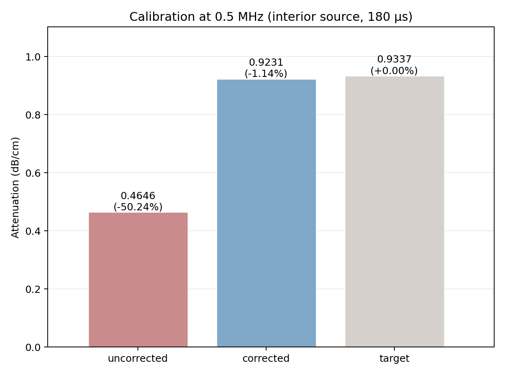
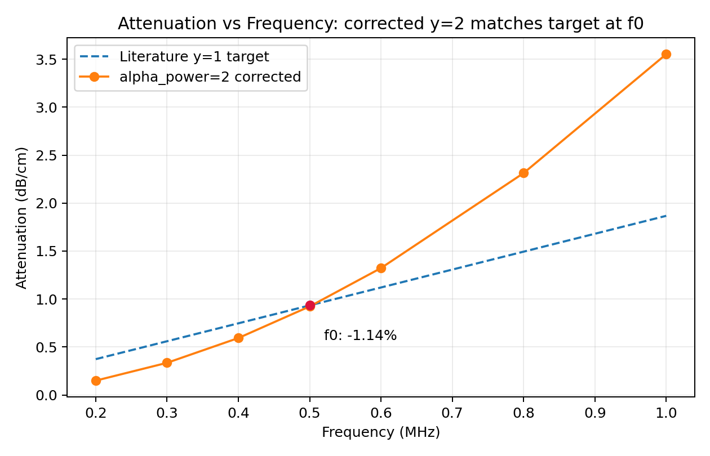
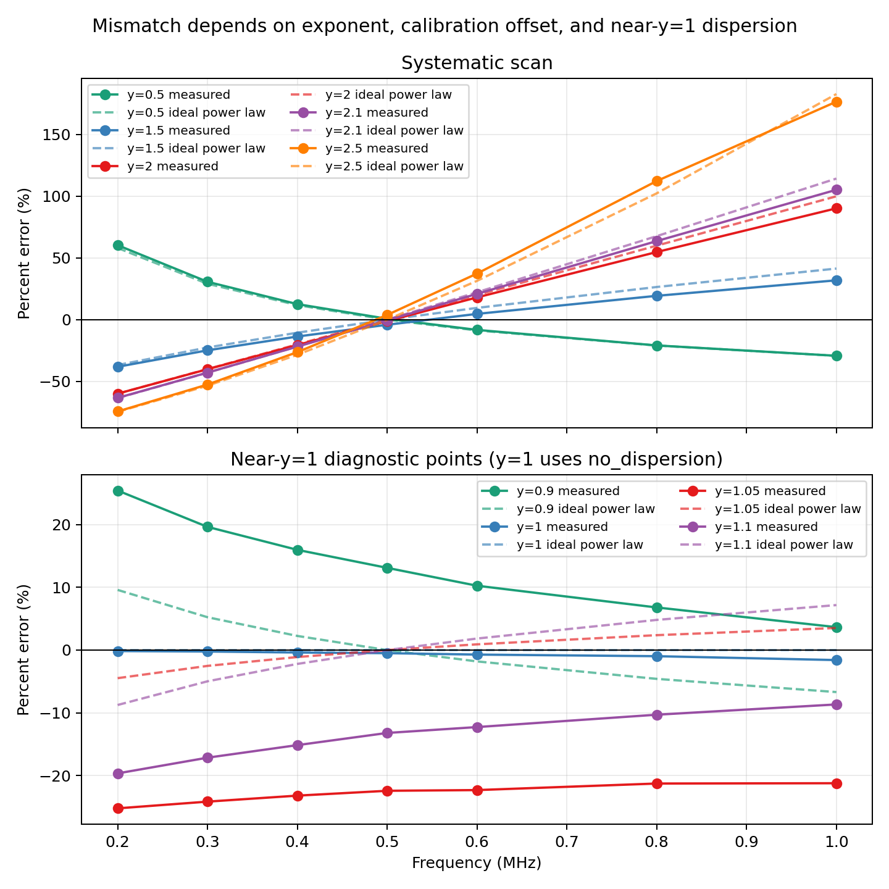
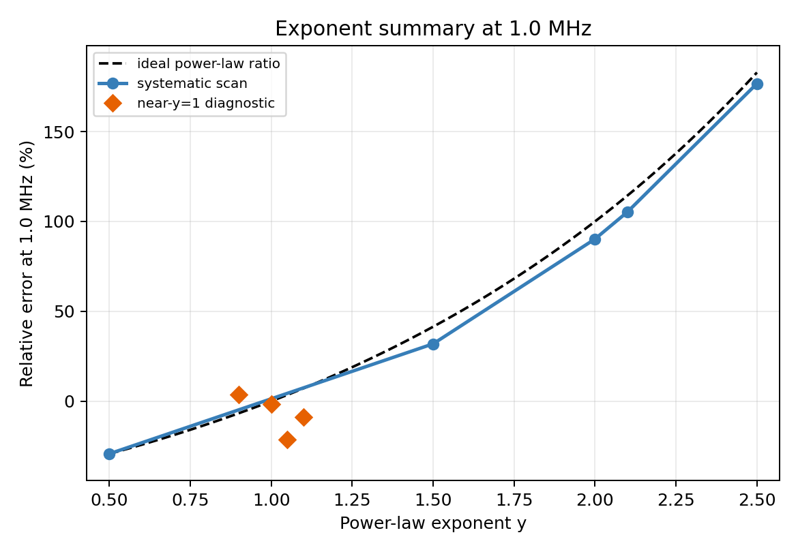
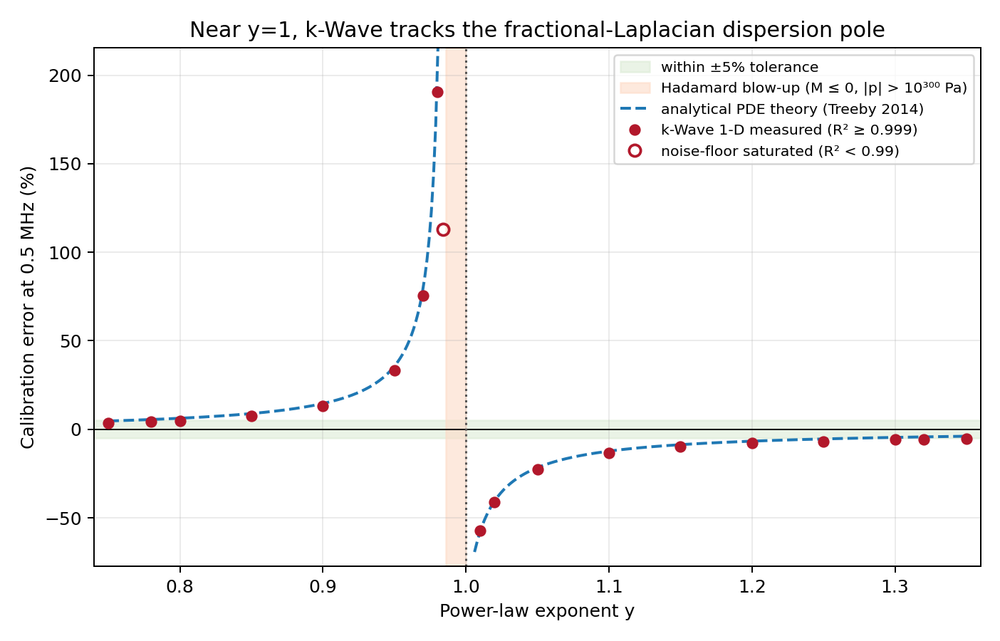
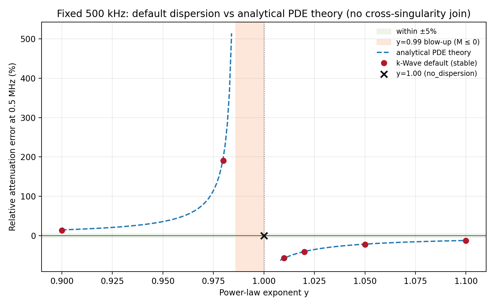
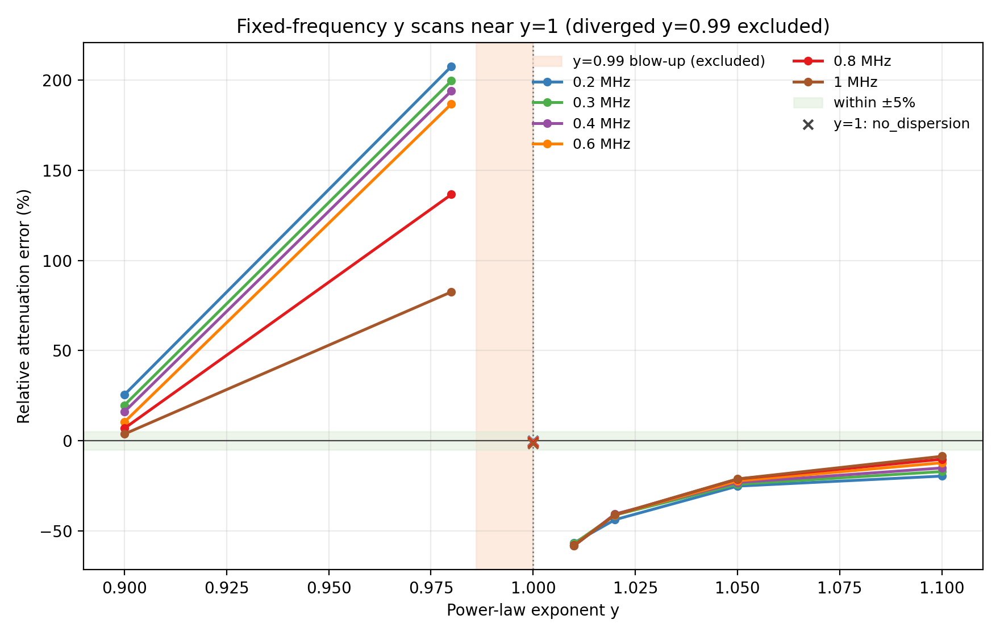
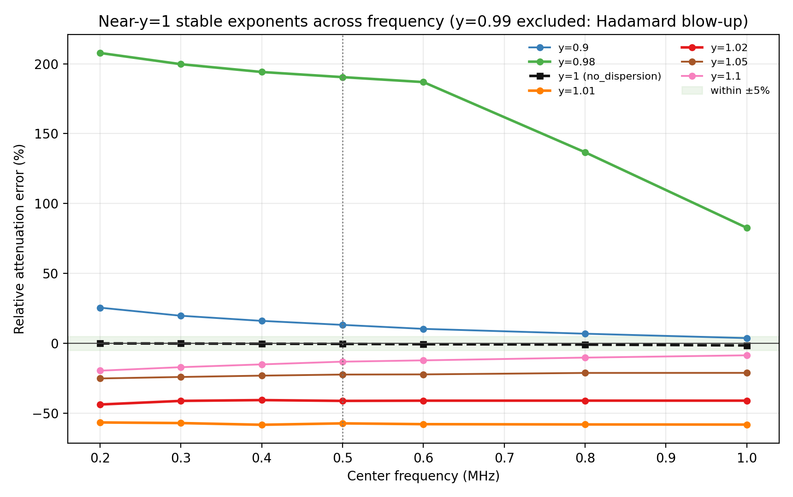
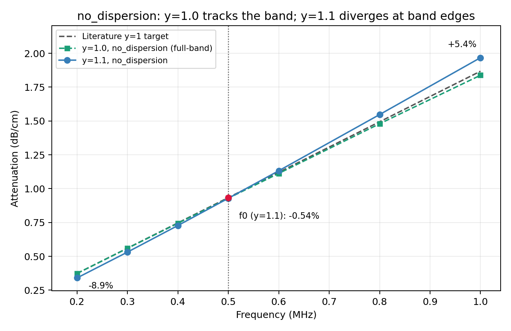

# kwave-power-law-attenuation-calibration

[中文 README](README_ZH.md)

[Experimental report (PDF)](report.pdf). LaTeX source: [`report.tex`](report.tex); rebuild with `pdflatex report.tex`, three passes.

> **Key idea:** Correctly converting a literature attenuation coefficient to k-Wave's power-law parameterization is only the prerequisite—near the dispersion pole $y=1$, k-Wave's first-order fractional-Laplacian state equation exhibits large analytical attenuation distortion, superluminal or slowed phase speed, and unconditional Hadamard elliptic blow-up. This project audits both parameter transfer and solver physics end-to-end.

  [](https://github.com/Yuewang04/kwave-power-law-attenuation-calibration/actions/workflows/reproduce.yml) [](LICENSE) [](https://doi.org/10.5281/zenodo.23804833)

## Contents

- [TL;DR](#tldr)
- [v1.1.0 Scientific Revision & Erratum Note](#v110-scientific-revision--erratum-note)
- [Quick guidance: which y should I use?](#quick-guidance-which-y-should-i-use)
- [Analytical theory: parameter transfer and fractional-Laplacian dispersion](#analytical-theory-parameter-transfer-and-fractional-laplacian-dispersion)
- [Part 1: Reference-frequency calibration and exponent sweep](#part-1-reference-frequency-calibration-and-exponent-sweep)
- [Part 2: Near-y=1 dispersion distortion, scaling, and Hadamard blow-up](#part-2-near-y1-dispersion-distortion-scaling-and-hadamard-blow-up)
- [Part 3: Audit of k-Wave workarounds (`fitPowerLawParams`, `no_dispersion`, CUDA)](#part-3-audit-of-k-wave-workarounds-fitpowerlawparams-no_dispersion-cuda)
- [Conclusion](#conclusion)
- [Reproduction](#reproduction)
- [Limitations](#limitations)
- [Author & Citation](#author)
- [References](#references)

## TL;DR

- **Prerequisite (Parameter Transfer at $y=2$):** Copying a linear literature coefficient ($y=1$, `1.8675 dB/(cm·MHz)`) directly into k-Wave's quadratic $y=2$ model biases simulated attenuation at $0.5\text{ MHz}$ by **−50.24%**. Rescaling via $\alpha_{\mathrm{coeff}}(y)=\alpha_{\mathrm{lit}} f_0^{1-y}$ (`f0` in MHz) reduces the error to **−1.14%** ($R^2 = 0.999997$, $c_p = 3103.0\text{ m/s}$).
- **Near-$y=1$ Attenuation & Phase-Speed Distortion:** Under k-Wave's default dispersive mode, the fractional-Laplacian equation of state delivers the exact analytical attenuation $\alpha_{\mathrm{actual}}(\omega) = \alpha_0 \omega^y / [1 - (y+1)\alpha_0 c_0 \tan(\pi y/2)\omega^{y-1}]$. At $y=1.01$, k-Wave yields a **−57.37%** frequency-independent attenuation deficit across $0.2\text{--}1.0\text{ MHz}$ (analytical: **−57.58%**) *and* shifts phase speed by **+54.8%** ($c_p = 4797.9$ vs $3100\text{ m/s}$), matching the **+57%** excess peak pressure in the 3-D control. At $y=0.98$, attenuation jumps by **+190.45%** (analytical: **+201.51%**) while phase speed drops to $1818.7\text{ m/s}$.
- **Unconditional Hadamard Blow-Up at $y=0.99$:** When $1 - \eta k^{y-1} \le 0$ ($M(k_0) = -0.3505 < 0$ at $y=0.99$), the effective squared sound speed becomes negative and the wave equation turns Hadamard-elliptic. Both 1-D (**−9.44×10³⁰¹ Pa** across all frequencies $0.2\text{--}1.0\text{ MHz}$ and timesteps `dt, dt/2, dt/4`) and 3-D (**~10³⁰ Pa** in MATLAB and CUDA) explode unconditionally.
- **Workaround Audit (`fitPowerLawParams` vs `no_dispersion`):** k-Wave's built-in `fitPowerLawParams` restores attenuation amplitude near $y=1$ (−0.78% to −1.41% for $y_{\mathrm{desired}} \in [1.00, 1.10]$) **but preserves +54.7% to +103.7% superluminal phase-speed distortion** ($c_p = 4797\text{--}6316\text{ m/s}$) and still diverges for $y_{\mathrm{desired}} = 0.99$. Exact $y=1$ with `no_dispersion` tracks the linear law over the full $0.2\text{--}1.0\text{ MHz}$ band (−0.16% to −1.59%, $c_p \approx 3103\text{ m/s}$) in MATLAB, but is rejected/ignored by the tested CUDA v1.3 binary.

## v1.1.0 Scientific Revision & Erratum Note

Relative to v1.0.0, **v1.1.0** resolves every experimental and engineering limitation flagged during independent audit:
1. **Standard Interior-Source Setup (`180 µs`):** All 1-D benchmarks now place the source strictly inside the physical medium (`source_idx = 35`, 15 cells clear of the 20-point PML) and extend the record from $90\text{ µs}$ to **$180\text{ µs}$** so dispersively slowed packets ($c_p \approx 1767\text{ m/s}$ at $y=0.98$) clear all sensors without truncation (`y=0.98` updates from `+143.11%, R²=0.96` to `+190.45%, R²=0.999997`, matching analytical theory `+201.51%`).
2. **Correction of the v1.0.0 $y=0.99$ 1-D "Collapse" Erratum:** v1.0.0 recorded only signed positive `p_max` ($\max_t p$), which missed monotonic negative-going blow-up (`p_min = −8.96×10³⁰¹ Pa`) and left only $10^{-4}\text{ Pa}$ initial positive noise in `p_max`. Recording both `p_max` and `p_min` (`max(|p_max|, |p_min|)`) proves that 1-D and 3-D fail by the exact same Hadamard instability.
3. **Correction of the "Non-Exponential Scaling" Interpretation:** At $y=1.05$, doubling `alpha_coeff` scales attenuation sub-linearly (`0.4085, 0.7242, 1.1831 dB/cm`) **not** because decay is non-exponential ($R^2 \ge 0.999988$ throughout), but because $\alpha_0$ appears in the dispersion denominator $1 - (y+1)\alpha_0 c_0 \tan(\pi y/2)\omega^{y-1}$ (analytical predictions: `0.4102, 0.7316, 1.2028 dB/cm`).
4. **100% End-to-End Code Reproducibility:** All JSON files (including the previously unscripted `singularity_scan.json`, `tan_scaling_check.json`, `grid_resolution_check.json`, `y11_no_dispersion.json`, plus full-band `y=1`, Part 3, and `fitPowerLawParams` audits) are now generated directly by [`src/matlab/run_all_benchmarks.m`](src/matlab/run_all_benchmarks.m).

## Quick guidance: which y should I use?

| Route | Configuration | Amplitude at $f_0$ | Full-band ($0.2\text{--}1.0\text{ MHz}$) | Phase speed $c_p$ | CUDA v1.3 safety | Verdict |
|---|---|---|---|---|---|---|
| **Route A (Recommended)** | `y = 2`, default dispersion + `f0^(1-y)` | **−1.14%** | Quadratic $(f/f_0)^1$ | Exact (`3103 m/s`, $\tan(\pi)=0$) | Safe | **Default choice** for pulsed/broadband & GPU |
| **Route B** | `y = 1`, `alpha_mode = 'no_dispersion'` | **−0.49%** | **−0.16% to −1.59%** | Constant (`3103 m/s`, no KK) | **Rejected by CUDA v1.3** | MATLAB CPU narrowband/linear-band only |
| **Route C (Avoid)** | $y \in [0.80, 1.35] \setminus \{1\}$, default dispersion | **−57% to +190%**, or blow-up | Distorted | **1351–4798 m/s** | Blow-up at $y=0.99$; ignores `no_dispersion` | **Trap zone** — do not use |
| **Route D (`fitPowerLawParams`)** | Built-in optimizer near $y=1$ | **−0.78% to −1.41%** ($y \ge 1$) | Matched to target power | **+55% to +104% distortion**; diverges for $y=0.99$ | Same GPU trap | **Unsafe for phase-sensitive focusing** |

### Before/after code: matching the coefficient

```diff
 f0_MHz = 0.5;                 % MHz (do not use Hz here)
 lit_coeff = 1.867466;         % dB/(cm*MHz), 21.5 Np/(MHz*m), y=1 literature law
-medium.alpha_coeff = lit_coeff;                    % WRONG: copied directly
-medium.alpha_power = 2;
+y = 2;
+medium.alpha_coeff = lit_coeff * f0_MHz^(1-y);     % RIGHT: match at f0
+medium.alpha_power = y;
```

## Analytical theory: parameter transfer and fractional-Laplacian dispersion

### 1. Parameter matching at reference frequency $f_0$

Matching $\alpha_{\mathrm{kwave}}(f)=\alpha_{\mathrm{coeff}}(y)f^y$ to the linear law $\alpha_{\mathrm{lit}}(f)=\alpha_{\mathrm{lit,coeff}}f$ at $f_0$ (in **MHz**) gives:

$$
\alpha_{\mathrm{coeff}}(y)=\alpha_{\mathrm{lit,coeff}}f_0^{1-y},\qquad
\frac{\alpha_{\mathrm{kwave}}(f)}{\alpha_{\mathrm{lit}}(f)}=\left(\frac{f}{f_0}\right)^{y-1}.
$$

### 2. Why default dispersion breaks near $y = 1$

In k-Wave's absorbing state equation (`kspaceFirstOrder1D.m` / `kspaceFirstOrder_createAbsorptionVariables.m`), pressure is updated via two fractional-Laplacian operators:

$$
p = c_0^2 \left[\rho_x + \tau (-\nabla^2)^{\frac{y}{2}-1}\frac{\partial \rho_x}{\partial t} - \eta (-\nabla^2)^{\frac{y-1}{2}}\rho_x\right],
\qquad
\tau = -2\alpha_0 c_0^{y-1},\quad
\eta = 2\alpha_0 c_0^y \tan\!\left(\frac{\pi y}{2}\right),
$$

where $\alpha_0 = \mathrm{db2neper}(\alpha_{\mathrm{coeff}}, y)$. Because $\tan(\pi y/2)$ has poles at odd integers ($y = 1, 3, \dots$), two exact analytical regimes govern the solver (Treeby & Cox 2010, 2014; `fitPowerLawParams.m`):

1. **Effective stiffness & Hadamard stability boundary:** In Fourier space, the dispersive stiffness multiplier is $M(k) = 1 - \eta k^{y-1}$. Whenever $M(k) \le 0$ (which occurs for $y < 1$ close enough to 1 that $\eta > 0$ exceeds $k^{1-y}$), $c_{\mathrm{eff}}^2 = c_0^2 M(k) \le 0$, turning the hyperbolic wave equation into an **elliptic Hadamard ill-posed PDE** with exponentially growing modes $\lambda_+ > 0$ regardless of timestep `dt`.
2. **Actual PDE attenuation & phase speed ($M(k) > 0$):**

$$
\alpha_{\mathrm{actual}}(\omega) = \frac{\alpha_0 \omega^y}{1 - (y+1)\alpha_0 c_0 \tan\!\left(\frac{\pi y}{2}\right)\omega^{y-1}},
\qquad
c_p(\omega) \approx c_0 \sqrt{1 - \eta k_0^{y-1}}.
$$

At $y=2$, $\tan(\pi) = 0 \implies \eta = 0$, so dispersion vanishes and the solver delivers $\alpha_0 \omega^2$ at $c_0$. Near $y = 1^+$, $\tan(\pi y/2) < 0$ makes the denominator $> 1$ (suppressing attenuation and driving superluminal $c_p > c_0$). Near $y = 1^-$, $\tan(\pi y/2) > 0$ makes the denominator $< 1$ (amplifying attenuation and slowing $c_p < c_0$) until $M(k) \le 0$ triggers exponential blow-up.

## Part 1: Reference-frequency calibration and exponent sweep

Homogeneous 1-D MATLAB k-Wave setup: `alpha_lit = 1.867466 dB/(cm·MHz)` (`21.5 Np/(MHz·m)`), $f_0 = 0.5\text{ MHz}$ (target $0.9337\text{ dB/cm}$), $c_0 = 3100\text{ m/s}$, $\rho_0 = 2200\text{ kg/m}^3$, 18-cycle toneburst at `source_idx = 35` (`PML = 20`, `180 µs`), six sensors spanning $26\text{--}126\text{ mm}$ plus an adjacent $+0.5\text{ mm}$ phase-probe sensor.

| $y$ | $\alpha_{\mathrm{coeff}}$ | Cal. Error (%) | $R^2$ | Measured $c_p$ (m/s) | Status |
|---:|---:|---:|---:|---:|---|
| 0.5 | 1.320498 | +0.73 | 0.999992 | 3069.5 | usable |
| 0.9 | 1.742408 | +13.11 | 0.999999 | 2887.1 | sensitivity |
| 1.0 | 1.867466 | −0.49 | 0.999999 | 3102.8 | `no_dispersion` |
| 1.05 | 1.933322 | −22.44 | 0.999988 | 3500.6 | sensitivity |
| 1.1 | 2.001501 | −13.21 | 0.999999 | 3303.5 | sensitivity |
| 1.5 | 2.640996 | −4.12 | 0.999999 | 3135.2 | usable |
| **2.0** | **3.734933** | **−1.14** | **0.999997** | **3103.0** | **usable (uncorrected: −50.24%)** |
| 2.1 | 4.003002 | −0.50 | 0.999998 | 3097.9 | usable |
| 2.5 | 5.281992 | +3.85 | 0.999990 | 3069.7 | usable |
| 3.0 | — | — | — | — | rejected (`0 < y < 3`) |



*Figure 1. Calibration at 0.5 MHz ($y=2$): uncorrected (`−50.24%`) vs. reference-frequency matched (`−1.14%`) vs. target (`0.9337 dB/cm`).*



*Figure 2. Corrected $y=2$ model matches the linear target at $f_0 = 0.5\text{ MHz}$ and scales quadratically away from $f_0$.*



*Figure 3. Systematic scan points (`0.5, 1.5, 2, 2.1, 2.5`) follow the ideal power-law ratio $(f/f_0)^{y-1}-1$, whereas near-$y=1$ points (`0.9, 1.05, 1.1`) systematically deviate due to the dispersion denominator.*



*Figure 4. Relative error evaluated at 1.0 MHz across exponents.*

## Part 2: Near-y=1 dispersion distortion, scaling, and Hadamard blow-up



*Figure 5. Fine scan across $y \in [0.75, 1.35]$ at $0.5\text{ MHz}$. Measured k-Wave errors (red dots) track the analytical Treeby & Cox (2014) PDE curve (blue dashed) across both sides of the $y=1$ pole. At $y=0.984$ (open circle, $R^2=0.70$), $+514\%$ theoretical attenuation (~72 dB loss over 126 mm) hits the dynamic-range floor. At $y=0.99$ (shaded orange band), $M(k_0)=-0.3505 < 0$ triggers Hadamard blow-up (`|p| = 9.44×10³⁰¹ Pa`).*

### 1. Multi-frequency invariance & Hadamard blow-up verification

Scanning $f \in [0.2, 1.0]\text{ MHz}$ confirms the analytical predictions across the band (`results/near_y_frequency_y*.json` and `results/controls_y098.json`):

- **$y = 1.01$ (`M(k0) = +2.35 > 0`):** Attenuation deficit stays flat at **−56.71% to −58.38%** across $0.2\text{--}1.0\text{ MHz}$ ($R^2 = 0.974\text{--}0.99993$; analytical: **−57.45% to −57.74%**), with superluminal phase speed **$c_p = 4689\text{--}4798\text{ m/s}$** (analytical: $4752.7\text{ m/s}$ at $0.5\text{ MHz}$).
- **$y = 1.02$ (`M(k0) = +1.68 > 0`):** Attenuation deficit is **−40.71% to −43.88%** ($R^2 \ge 0.99996$; analytical: **−40.05% to −41.19%**), with $c_p = 3934\text{--}4032\text{ m/s}$.
- **$y = 0.98$ (`M(k0) = +0.325 > 0`):** Attenuation rises to **+190.45%** at $0.5\text{ MHz}$ ($R^2 = 0.999997$; analytical: **+201.51%**) and phase speed slows to **$c_p = 1818.7\text{ m/s}$** (analytical: $1767.0\text{ m/s}$). Timestep refinement (`dt, dt/2, dt/4`) leaves peak error unchanged (`+190.45%, +190.18%, +190.15%`, $R^2 = 1.0000$) and agrees with gated FFT spectral fits (`+171.3%` to `+172.6%`).
- **$y = 0.99$ (`M(k0) = −0.3505 < 0`):** Unconditional Hadamard blow-up across all 7 frequencies ($|p|_{\max} = 5.9\times 10^{301}\text{ to }9.4\times 10^{301}\text{ Pa}$) and all timesteps `dt, dt/2, dt/4` (`9.44e301, 5.99e301, 6.15e301 Pa`), with `p_min_neg = -8.96e301 Pa` and `p_max_pos = +1.03e-4 Pa` at sensor 1.







### 2. Nonlinear scaling with `alpha_coeff` and grid convergence (`y = 1.05`)

Scaling `alpha_coeff` by `0.5×, 1×, 2×` at $y=1.05$ (`results/tan_scaling_check.json`) demonstrates why the error is **not** a fixed percentage bias:

| Exponent | Scale | $\alpha_{\mathrm{coeff}}$ | Ideal power law (dB/cm) | Measured k-Wave (dB/cm) | Analytical PDE (dB/cm) | $R^2$ |
|---|---:|---:|---:|---:|---:|---:|
| $y=1.05$ | 0.5× | 0.966661 | 0.4669 | 0.4085 (−12.50%) | 0.4102 (−12.14%) | 0.999994 |
| $y=1.05$ | 1.0× | 1.933322 | 0.9337 | 0.7242 (−22.44%) | 0.7316 (−21.65%) | 0.999988 |
| $y=1.05$ | 2.0× | 3.866644 | 1.8675 | 1.1831 (−36.65%) | 1.2028 (−35.59%) | 0.999999 |
| $y=2.00$ (control) | 0.5 / 1 / 2× | 1.867–7.470 | 0.467 / 0.934 / 1.867 | 0.465 / 0.923 / 1.824 | 0.467 / 0.934 / 1.867 | $\ge 0.999989$ |

Spatial decay remains strictly exponential ($R^2 \ge 0.999988$); the sub-linear scaling comes directly from $\alpha_0$ appearing in the fractional-Laplacian dispersion denominator. Grid refinement at $y=1.05$ (`dx = 0.5, 0.25, 0.125 mm`, `results/grid_resolution_check.json`) yields `−22.44%, −22.36%, −22.27%`, confirming it is a continuum PDE effect rather than a spatial discretization artifact.

## Part 3: Audit of k-Wave workarounds (`fitPowerLawParams`, `no_dispersion`, CUDA)

### 1. Does k-Wave's `fitPowerLawParams` solve the near-$y=1$ problem?

k-Wave provides `fitPowerLawParams(a0, y, c0, f_min, f_max)` to invert the dispersion denominator numerically (`results/fit_power_law_params_audit.json`, $c_0 = 3100\text{ m/s}$, band $0.2\text{--}1.0\text{ MHz}$):

| Desired $y$ | Fitted $(\alpha_0, y_{\mathrm{fit}})$ | Field status | Attenuation error at $f_0$ | Measured $c_p$ (m/s) | Phase-speed distortion |
|---:|---|---|---:|---:|---:|
| 0.99 | `(15.7517, 1.0154)` | **diverged** | — | — | **Unusable (blow-up)** |
| 1.00 | `(8.0416, 1.0178)` | stable | −1.41% | **6315.6** | **+103.7%** |
| 1.01 | `(4.4853, 1.0237)` | stable | −0.78% | **4796.5** | **+54.7%** |
| 1.05 | `(2.4935, 1.0640)` | stable | −1.23% | **3499.7** | **+12.9%** |
| 1.10 | `(2.3065, 1.1144)` | stable | −1.23% | **3302.7** | **+6.5%** |
| 1.50 | `(2.7385, 1.5149)` | stable | −1.66% | 3134.6 | +1.1% |
| 2.00 | `(3.7349, 2.0000)` | stable | −1.14% | 3103.0 | +0.1% |

**Key finding:** `fitPowerLawParams` rescues **amplitude** for $y \ge 1$, **but leaves a +55% to +104% superluminal phase-speed error** near $y=1$ (and fails to stabilize $y_{\mathrm{desired}} = 0.99$). For transcranial focusing, a factor-of-2 skull sound-speed error completely misplaces the focal spot.

### 2. Worked cortical-bone example (`c = 2800 m/s`, `rho = 1900 kg/m³`) & full-band `no_dispersion`

| Mode (`results/worked_example_part3.json`) | $\alpha_{\mathrm{coeff}}$ | $y$ | Attenuation (dB/cm) | Error vs target | Measured $c_p$ (m/s) |
|---|---:|---:|---:|---:|---:|
| Default dispersive, uncorrected | 1.867466 | 1.1000 | 0.7687 | −17.68% | 2954.9 |
| Default dispersive, $f_0$-matched | 2.001501 | 1.1000 | 0.8167 | −12.53% | 2965.4 |
| `no_dispersion`, uncorrected | 1.867466 | 1.1000 | 0.8665 | −7.20% | 2802.3 |
| `no_dispersion`, $f_0$-matched | 2.001501 | 1.1000 | 0.9283 | **−0.58%** | 2802.5 |
| `no_dispersion`, exact linear | 1.867466 | 1.0000 | 0.9288 | **−0.53%** | 2802.5 |
| Default dispersive + `fitPowerLawParams` | 2.276734 | 1.1130 | 0.9208 | −1.38% | 2964.9 (+5.9%) |



*Figure 6. Under `no_dispersion`, exact $y=1.0$ (`results/y1_no_dispersion_fullband.json`) tracks the linear target across $0.2\text{--}1.0\text{ MHz}$ (−0.16% to −1.59%, $c_p = 3100\text{--}3105\text{ m/s}$), whereas $y=1.1$ matches at $0.5\text{ MHz}$ (−0.58%) and diverges at the band edges (−8.9% at 0.2 MHz, +5.4% at 1.0 MHz).*

### 3. CUDA v1.3 backend control (`results/cuda_y1_backend_control_20260914.json`)

In an isolated 3-D homogeneous control ($48 \times 20 \times 20$, $c=2800\text{ m/s}$, k-Wave 1.4.1 wrapper + `kspaceFirstOrder-CUDA v1.3` on RTX 4090 D):
- `kspaceFirstOrder-CUDA v1.3` **rejected exact $y=1$** (`"Illegal value of alpha_power (may not equal to 1.0)."`).
- `kspaceFirstOrder-CUDA v1.3` **ignored `medium.alpha_mode = 'no_dispersion'`** (serialized HDF5 payloads and output fields were bitwise identical between `default` and `no_dispersion`), leaving `y=1.01` with a **+56.7%** peak-pressure excess (`2.736 MPa` vs `1.746 MPa`) and `y=0.99` blowing up to `1.09e30 Pa` across `CFL = 0.1, 0.05, 0.025`.

## Conclusion

To avoid both algebraic mismatch and the fractional-Laplacian singularity in k-Wave, **use $y=2$ with $\alpha_{\mathrm{coeff}} = \alpha_{\mathrm{lit}} f_0^{1-y}$ (`f0` in MHz)** whenever phase coupling and GPU/CUDA portability matter. Use $y=1$ with `no_dispersion` only on CPU MATLAB paths when linear broadband attenuation is strictly required and Kramers–Kronig phase dispersion is expendable; never rely on $y \approx 1$ under default dispersion or `fitPowerLawParams` without checking phase-speed distortion.

## Reproduction

> [!TIP]
> **Instant Figure & Unit-Test Reproduction (No MATLAB Required):**
> ```bash
> pip install -r requirements.txt
> python src/simulate_1d.py
> python src/run_experiments.py --plot-only
> python src/plot_near_y1_frequency_scan.py
> ```

### Full MATLAB 1-D Reproduction

With MATLAB (`R2026a` + k-Wave `1.4.1`) on `PATH`:

```bash
python src/run_experiments.py
python src/plot_near_y1_frequency_scan.py
```

Or directly inside MATLAB: `addpath('src/matlab'); run_all_benchmarks;`. Every 1-D JSON file in `results/` is regenerated from committed code:

| File | Produced by |
|---|---|
| `results/results.json`, `results/matlab_results.json`, `results/results_n_sweep.json` | `src/matlab/run_all_benchmarks.m` (`run_kwave_experiments.m`) |
| `results/near_y_frequency_y*.json` | `src/matlab/run_near_y_frequency_scans.m` |
| `results/controls_y098.json` | `src/matlab/run_controls.m` |
| `results/singularity_scan.json`, `results/tan_scaling_check.json`, `results/grid_resolution_check.json` | `src/matlab/run_singularity_and_diagnostics.m` |
| `results/y11_no_dispersion.json`, `results/y1_no_dispersion_fullband.json` | `src/matlab/run_singularity_and_diagnostics.m` |
| `results/worked_example_part3.json`, `results/fit_power_law_params_audit.json` | `src/matlab/run_singularity_and_diagnostics.m` |
| `results/interior_source_validation.json` | `src/matlab/validate_interior_source.m` |
| `results/cuda_y1_backend_control_20260914.json` | `src/matlab/validate_kwave_cuda_y1_*.m` (optional GPU control) |

## Limitations

- All 1-D and 3-D benchmarks model homogeneous media; real transcranial attenuation also involves scattering in trabecular bone, skull refraction, and longitudinal-to-shear mode conversion, which are not represented by `alpha_coeff`.
- `no_dispersion` disables causal Kramers–Kronig phase coupling; while benign for narrowband CW/tonebursts, it alters dispersion for short broadband pulses.
- CUDA behavior was verified on one pairing (k-Wave 1.4.1 wrapper + `kspaceFirstOrder-CUDA v1.3`); newer k-Wave C++/CUDA releases should be verified independently.

## Author

Yue Wang ([Yuewang04](https://github.com/Yuewang04))

## Citation

Machine-readable metadata is provided in [`CITATION.cff`](CITATION.cff) and [`.zenodo.json`](.zenodo.json).

```bibtex
@software{wang2026kwave,
  author       = {Wang, Yue},
  title        = {kwave-power-law-attenuation-calibration: Reproducible numerical and analytical audit of k-Wave power-law attenuation calibration near y=1},
  month        = nov,
  year         = 2026,
  publisher    = {Zenodo},
  version      = {v1.1.0},
  doi          = {10.5281/zenodo.23804833},
  url          = {https://doi.org/10.5281/zenodo.23804833}
}
```

The concept DOI [10.5281/zenodo.23804833](https://doi.org/10.5281/zenodo.23804833) always resolves to the latest version (v1.0.0 archive: [doi:10.5281/zenodo.23804834](https://doi.org/10.5281/zenodo.23804834)).

## References

- Aubry, J.-F. et al. “Benchmark problems for transcranial ultrasound simulation: Intercomparison of compressional wave models.” *JASA* 152(2), 1003–1019 (2022). DOI: [10.1121/10.0013426](https://doi.org/10.1121/10.0013426)
- Treeby, B. E. & Cox, B. T. “Modeling power law absorption and dispersion for acoustic propagation using the fractional Laplacian.” *JASA* 127(5), 2741–2748 (2010). DOI: [10.1121/1.3377056](https://doi.org/10.1121/1.3377056)
- Treeby, B. E. & Cox, B. T. “Modeling power law absorption and dispersion in viscoelastic solids using a split-field and the fractional Laplacian.” *JASA* 136(4), 1490–1500 (2014). DOI: [10.1121/1.4894790](https://doi.org/10.1121/1.4894790)
- Singh, A., Jiménez-Gambín, S. & Konofagou, E. E. “An all-ultrasound cranial imaging method to establish the relationship between cranial FUS incidence angle and transcranial attenuation in non-human primates in 3D.” *Scientific Reports* 14, 1488 (2024). DOI: [10.1038/s41598-024-51623-5](https://doi.org/10.1038/s41598-024-51623-5)
- Bamber, J. C. “Attenuation and Absorption.” In *Physical Principles of Medical Ultrasonics*, 2nd ed., Ch. 4 (2004). DOI: [10.1002/0470093978.ch4](https://doi.org/10.1002/0470093978.ch4)
- k-Wave documentation, “The k-Wave Manual / power-law absorption and dispersion.” [k-wave.org](https://www.k-wave.org/documentation.php)

## Feedback and license

Questions, corrections, and reproducibility reports are welcome through [GitHub Issues](https://github.com/Yuewang04/kwave-power-law-attenuation-calibration/issues). Licensed under the MIT License; see [LICENSE](LICENSE).
