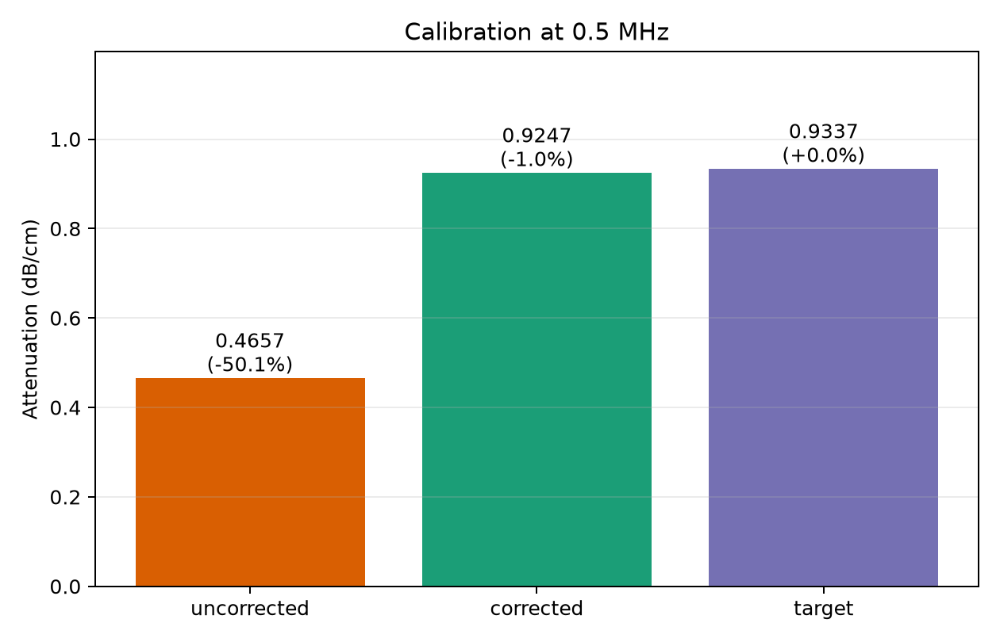
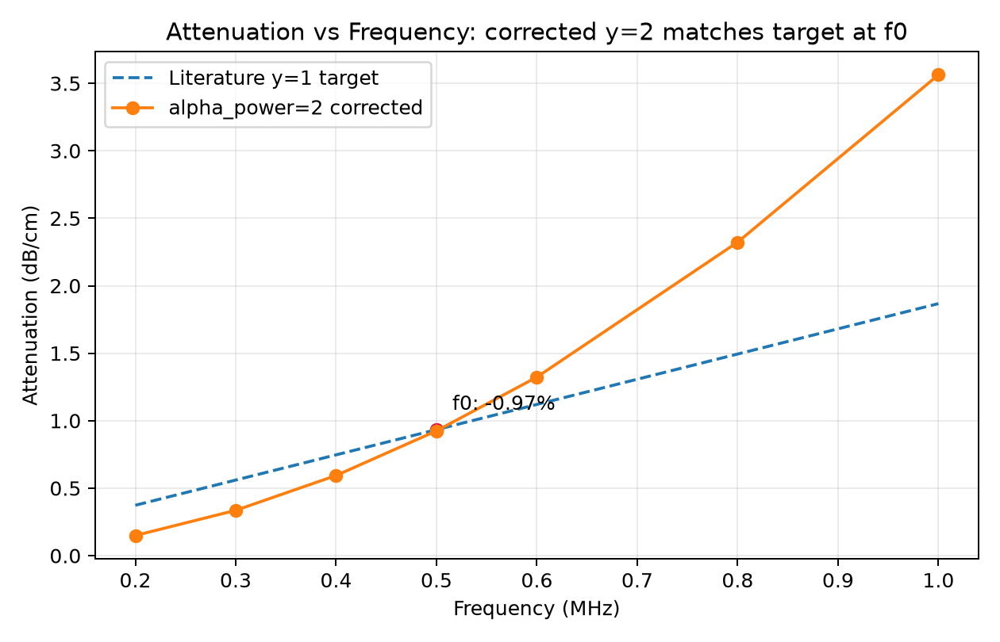
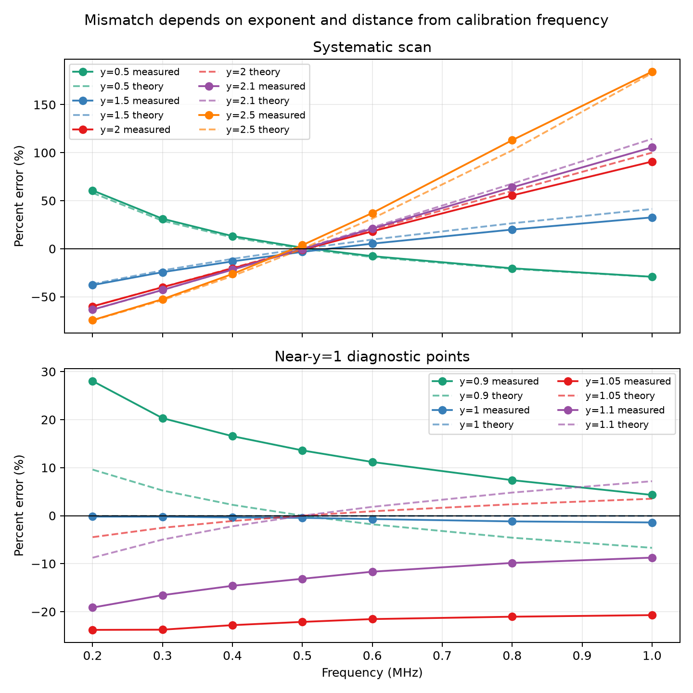
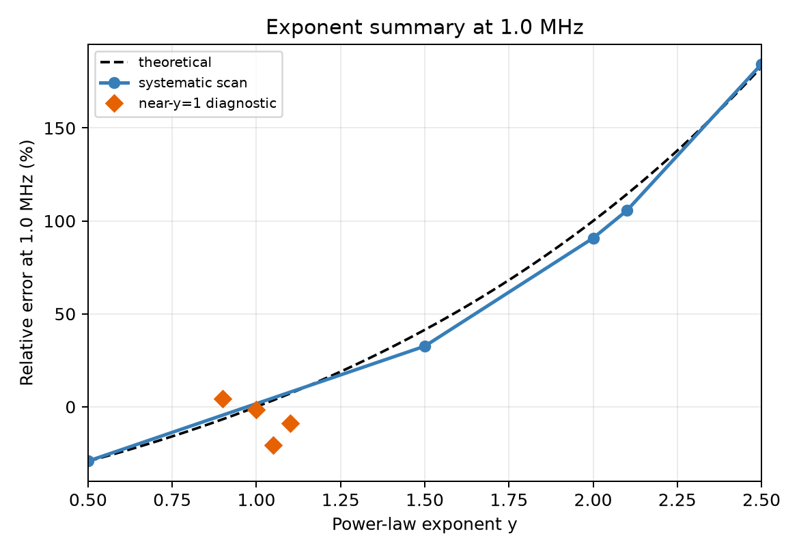
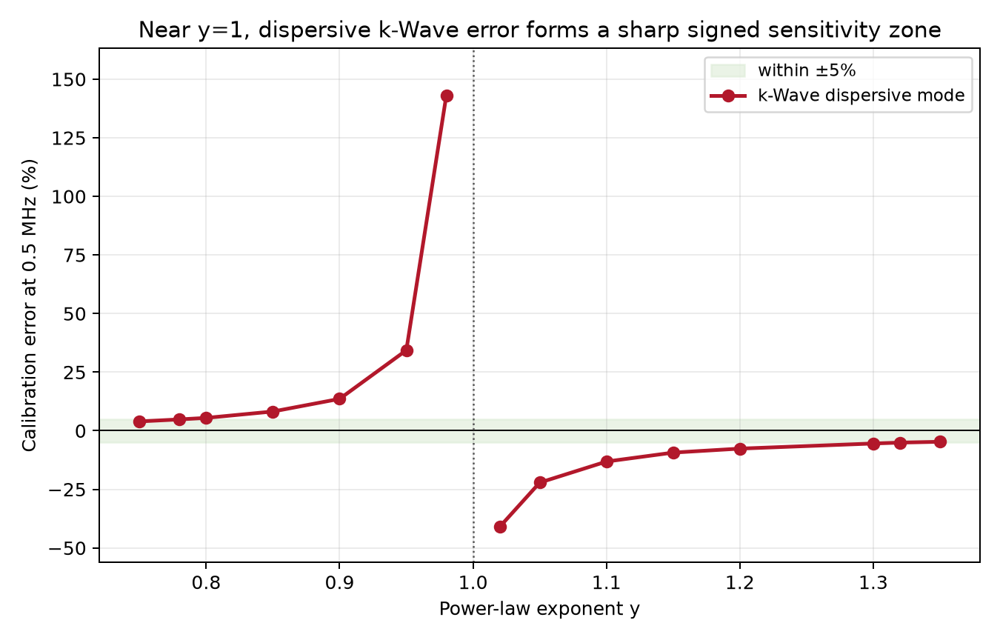
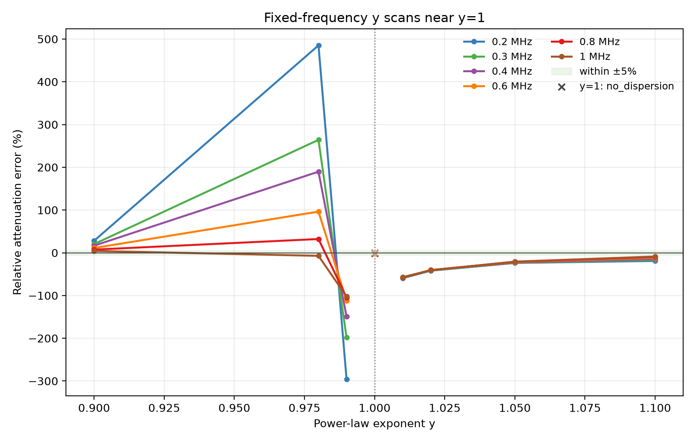
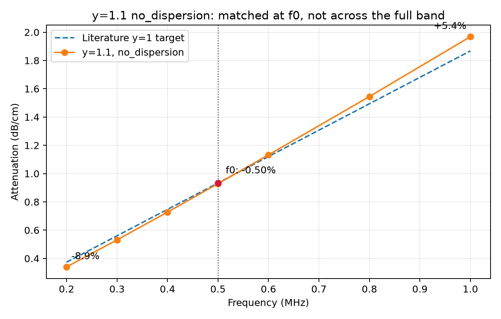

# kwave-power-law-attenuation-calibration

[English README](README.md)

[实验报告（PDF）](report.pdf)。LaTeX 源码：[`report.tex`](report.tex)，`pdflatex report.tex` 跑三遍即可重建。

> **核心观点：** 把文献衰减系数正确换算到 k-Wave 的幂律参数，并不等于数值求解器一定会给出正确的衰减。本项目在受控的一维设置下，把这两个问题分开审计。

  [](LICENSE)

## 目录

- [TL;DR](#tldr)
- [背景与动机](#背景与动机)
- [快速指南：我应该使用哪个 y？](#快速指南我应该使用哪个-y)
- [通用公式与推导](#通用公式与推导)
- [Part 1：解析校准与指数扫描](#part-1解析校准与指数扫描)
- [Part 2：y≈1附近的峰值压力衰减估计敏感性](#part-2y1-near-sensitivity)
- [与现有 k-Wave 指导的关系](#与现有-k-wave-指导的关系)
- [Part 3：实际意义与示例](#part-3实际意义与示例)
- [结论](#结论)
- [复现](#复现)
- [局限性](#局限性)
- [作者](#作者)
- [引用](#引用)
- [参考文献](#参考文献)
- [反馈与许可](#反馈与许可)

## TL;DR

- **问题1：** 如果把按线性频率律（y=1）报告的文献系数未经调整直接用于 k-Wave 的 y=2 幂律模型，仿真衰减会偏离校准频率；在本项目 y=2、0.5 MHz 的测试中，偏差为 −50.13%。使用推导出的公式匹配系数后，偏差降至 −0.97%。
- **问题2：** 在 k-Wave 默认色散模式下，使用接近但不等于1的幂律指数，可能在仿真正常运行且 R² 很高的情况下静默地产生较大的校准误差。在本项目测试中，较宽的 y≈1 区域误差超过 ±5%（离散扫描中落在区间外的点为 y=0.80，+5.48%，至 y=1.32，−5.07%）；在 y=1.1 切换到 `no_dispersion` 后，误差降至 −0.50%。
- **y≈1 的误差不是幂律失配。** y=1.01 时，0.2–1.0 MHz 全频段的衰减缺失为 −56.8% 至 −59.4%，R²≥0.999——几乎与频率无关；而该频段内理论幂律失配最多只有 ±1.4%。频率无关的偏移意味着求解器层面存在**乘性**衰减缺失，而不是指数取错。一项独立的 3-D 控制给出了相符的特征：同一 y=1.01 配置下，峰值压力相对 `no_dispersion` 高出 **+57%**（2.74 vs 1.75 MPa）。
- **y≈1 附近场本身可能失效，而百分比误差表会掩盖这一点。** y=0.99 时一维峰值压力塌到 10⁻⁵ Pa 量级并随距离上升，因此该指数不存在可用的衰减估计；在同一 3-D 控制中，该配置在 MATLAB 和 CUDA 两条路径、以及所测试的每个时间步上都发散到约 10³⁰ Pa。这些是定性失效，不是校准偏差。

## 背景与动机

经颅超声仿真需要可靠的颅骨衰减系数。这里有两个不同问题：文献常用线性频率律（y=1），而 k-Wave 使用可配置幂律，因此把系数直接复制到另一个指数时，在参考频率之外并不匹配；同时，k-Wave 幂律吸收模型所依据的色散关系在 y=1 处是奇异的，接近1的可接受输入仍可能使预期衰减与仿真衰减出现显著偏离。

我是在准备声学仿真数据集时遇到这个问题的。我参照的benchmark使用 y=2，而我查到的骨骼衰减文献值使用 y=1。一开始我把它当作参数定义的差异；换算结果不符合预期后，我搭建了一个小型1D benchmark来实际检查。

在本项目的1D测试中，未校准系数使仿真衰减产生了大约50%的偏差。这个量级值得在使用 k-Wave 输出进行剂量或焦点规划前独立核查。这里的证据来自受控1D设置，不代表真实颅骨几何。

## 快速指南：我应该使用哪个 y？

请根据你的仿真目标选择路线：

**路线A——y=2，默认色散模式。** 这是 Aubry et al.（2022）benchmark 的约定，也是本项目 Part 1 完整验证过的组合。适用：大多数场景，尤其当你希望保留频率相关的相位耦合（宽带/脉冲仿真时更重要）。使用 `alpha_coeff = lit_coeff × f0^(1-y)`，其中 y=2。**f0 必须用 MHz 代入，不能用 Hz**；由于指数通常不是整数，结果不是简单的十的幂次换算。在 k-Wave 的幂律吸收模型中，色散修正包含 tan(πy/2)，该项在 y=2 时为零。因此，切换 `alpha_mode` 不会改变 y=2 时的这一特定项；这并不保证所有求解器或后端在一般情况下都等效。

**路线B——y=1 配合 `no_dispersion`（本项目只在 MATLAB 求解器中验证）。** k-Wave 在 y=1 处有数学奇点，默认色散模式会报错，必须设置 `alpha_mode='no_dispersion'`。根据本项目推导的公式，比值 `(f/f0)^(y-1)` 在 y=1 时恒为1，因此理论上这个组合应在整个频段精确匹配文献目标。但本项目只验证了校准点的精度（−0.45%），没有像 y=2 或 y=1.1 那样做完整频率扫描去实际验证全频段行为。对于需要精确相位计算的应用（如经颅聚焦规划和相位像差校正），Route B 需要谨慎评估，因为移除随频率变化的声速耦合可能直接影响聚焦精度。⚠️ 如果计划使用 GPU/CUDA 后端，请先阅读[《与现有 k-Wave 指导的关系》中的后端可移植性提醒](#与现有-k-wave-指导的关系)，再依赖 `no_dispersion`。

**路线C——y 在 0.80–1.32 之间但不等于1。** Part 2 扫描显示，这个区间内默认色散模式会出现从十几个百分点到100%以上的校准误差，即使程序接受输入且 R² 仍然很高。除非你已经读过 Part 2 并理解这个陷阱，否则不建议在这个区间使用默认色散模式。

**本项目不推荐 near-y=1 的 Route D。** 仅仅避开与1完全相等，并不能证明存在安全的替代方案。仓库目前没有保存 y=0.99 时间步长细化和 y=1.01 衰减估计器检查的独立结果文件，因此这里不报告那两项后续检查的具体数字。目前也没有建立距离 y=1 多远才普遍安全的阈值。

### 代码对比：系数匹配前后

下面的 diff 用参考频率换算替换常见的未校准赋值，其中 `f0_MHz` 明确使用 **MHz**。

```diff
 f0_MHz = 0.5;                 % MHz（这里不要使用 Hz）
 lit_coeff = 1.86749;          % dB/(cm*MHz)，y=1 文献模型
-medium.alpha_coeff = lit_coeff;                    % 错误：直接复制
-medium.alpha_power = 2;
+y = 2;
+medium.alpha_coeff = lit_coeff * f0_MHz^(1-y);     % 正确：在 f0 匹配
+medium.alpha_power = y;
```

## 通用公式与推导

文献模型为 $\alpha_{\mathrm{lit}}(f)=\alpha_{\mathrm{lit,coeff}}f$，k-Wave模型为 $\alpha_{\mathrm{kwave}}(f)=\alpha_{\mathrm{coeff}}(y)f^y$。在校准频率 $f_0$ 匹配：

$$
\alpha_{\mathrm{coeff}}(y)f_0^y=\alpha_{\mathrm{lit,coeff}}f_0^1.
$$

两边除以 $f_0^y$：

$$
\alpha_{\mathrm{coeff}}(y)=\alpha_{\mathrm{lit,coeff}}f_0^{1-y},\qquad
\frac{\alpha_{\mathrm{kwave}}(f)}{\alpha_{\mathrm{lit}}(f)}=\left(\frac{f}{f_0}\right)^{y-1}.
$$

注意：为匹配 k-Wave 原生的 `alpha_coeff` 单位 dB/(cm·MHz^y)，f0 必须用 **MHz** 表示。若用 **Hz** 代入，结果不会只是简单乘上某个十的幂，因为指数 (1-y) 通常不是整数。

当 y=1 时，比值公式的指数为0，因此比值在所有频率都等于1。理论上，y=1 配合 `no_dispersion` 应在整个频段跟踪文献模型，但本项目只验证了校准点（误差 −0.45%，R²=0.999994），没有单独进行完整频率扫描。y=1 是 k-Wave 默认色散模式的特殊情形，必须使用 `alpha_mode='no_dispersion'`；y=0.9、1.05 和 1.1 是用于刻画 y≈1 敏感性的诊断点，不是推荐的工作值。默认色散保留符合因果关系的 Kramers–Kronig 相位耦合，因此许多 benchmark 仍使用 y=2；y=1 配合 `no_dispersion` 则放弃了这种随频率变化的声速耦合。

## Part 1：解析校准与指数扫描

1D MATLAB k-Wave实验使用 `alpha_lit_coeff=1.86749 dB/(cm·MHz)`、f0=0.5 MHz、c=3100 m/s、rho=2200 kg/m³、18周期 toneburst，6个传感器位于26–126 mm。每个传感器记录的 `p_max` 是 k-Wave 返回的最大正压，代码在拟合 ln(p_max) 与距离前取其绝对值。因此这里报告的是基于峰值压力的衰减估计，不是材料本征衰减系数的直接测量。系统扫描点为 y=0.5、1.5、2、2.1、2.5。另取 y=0.9、1.05、1.1 作为 y≈1 诊断点。
拟合使用全部六个源到传感器的距离。y=1 行使用 `no_dispersion` 作为特殊情形参考，不属于与默认色散点完全同类的比较。

读表说明：`校准误差` 是仿真衰减与 f0 处文献目标之间的百分比差异。`状态`中的 `可用（敏感）` 标记表示这三个 y 值是专门为探查 Part 2 所述的 y≈1 敏感性而采样的；它们不是推荐的工作指数，只是诊断点。

| y | alpha_coeff | 校准误差 (%) | R² | 状态 |
|---:|---:|---:|---:|---|
| 0.5 | 1.320515 | +1.06 | 0.999995 | 可用 |
| 0.9 | 1.742430 | +13.59 | 0.999999 | 可用（敏感） |
| 1.0 | 1.867490 | −0.45 | 0.999994 | 可用（`no_dispersion`） |
| 1.05 | 1.933347 | −22.12 | 0.999992 | 可用（敏感） |
| 1.1 | 2.001526 | −13.15 | 0.999999 | 可用（敏感） |
| 1.5 | 2.641030 | −3.28 | 0.999996 | 可用 |
| 2.0 | 3.734980 | −0.97 | 0.999986 | 可用 |
| 2.1 | 4.003052 | −0.38 | 0.999989 | 可用 |
| 2.5 | 5.282059 | +3.73 | 0.999985 | 可用 |
| 3.0 | — | — | — | `unsupported_by_kwave` |

y=3.0 被 k-Wave 拒绝，因此不报告其衰减值。需要注意，色散因子 `tan(πy/2)` 在**所有奇数整数**处都是奇异的，所以 y=3 与 y=1 属于同一类奇点；由于已提交的结果中没有保留原始报错信息，这里不推断 k-Wave 给出的具体拒绝理由。



图1：0.5 MHz处的柱状图。三根柱分别显示dB/cm单位的衰减：未修正（文献系数直接配合y=2使用）、修正（使用本项目公式在f0处匹配后的系数）和目标（f0处的文献y=1数值）。每根柱都标有数值及相对于目标的百分比误差。匹配系数消除了未修正柱中的主要校准偏差。



图2：折线图。横轴：频率（MHz），0.2至1.0。纵轴：衰减（dB/cm）。虚线：各频率处文献y=1目标。实线：修正后的y=2模型仿真衰减。两条线仅在标出的f0=0.5 MHz处相交；离开f0后，y=2模型的衰减随频率增长快于文献y=1直线，这是指数不同带来的预期结果。



图3：双面板折线图。两个面板的横轴均为频率（MHz），纵轴均为相对于文献目标的百分比误差。每个指数y使用同色的两条线：实线=测量（仿真）误差，虚线=由(f/f0)^(y-1)-1预测的理论误差。上方面板：系统扫描点（y=0.5、1.5、2、2.1、2.5），测量线与理论线基本重合。下方面板：y≈1诊断点（y=0.9、1、1.05、1.1），其中y=1.05和y=1.1的测量线明显偏离对应的理论虚线。



图4：散点/折线图。横轴：幂律指数y，0.5至2.5。纵轴：1.0 MHz处的相对误差（%）。黑色虚线：理想理论误差曲线。蓝色连接点：系统扫描点，基本遵循理论曲线。橙色菱形（不连接）：y≈1诊断点，明显偏离理论曲线。在 1.0 MHz 处，理论曲线本身在远离 y=1 时也远离零，因此本图展示的是相对**预期幂律失配**的偏离，而不是 ±5% 校准带；该带只在图5中给出，因为那里是在校准频率上评估的。

代数换算回答的是参数传递问题。它不能保证数值求解器会复现该衰减。这里有一个实用提醒：较高的 R² 只说明拟合区间内压力衰减近似指数形式，并不能证明恢复出的衰减系数正确。

<a id="part-2y1-near-sensitivity"></a>
## Part 2：y≈1附近的峰值压力衰减估计敏感性

k-Wave将y=1列为特殊输入，并建议使用邻近指数或 `alpha_mode='no_dispersion'`。该模式关闭幂律吸收与因果Kramers–Kronig相位行为耦合的色散修正。对本项目窄带toneburst是合理近似，但它放弃了随频率变化的声速耦合，宽带/脉冲仿真可能产生相位失真。我们最初是在 0.2 MHz 结果异常时注意到这个问题的；检查主要边界相关设置后，把同样的测试推广到不同 y，异常仍然出现。随后细扫得到 y=0.98 的 +143.11%（R²=0.96）和 y=1.02 的 −41.01%。离散扫描中落在 ±5% 之外的点从 y=0.80（+5.48%）到 y=1.32（−5.07%）；相邻的带内采样点是 y=0.78（+4.83%）和 y=1.35（−4.71%）。这些是设置相关的参考边界，不是普适常数。这里报告的是基于峰值压力的衰减估计，当前测试没有完全区分色散/模型效应、波形重塑、估计器偏差和数值离散误差。

### 控制检查

对代表性的 y=0.98 案例，时间步长细化得到的峰值压力相对误差分别为 143.11%（基线）、143.72%（dt/2）和 143.79%（dt/4），R² 分别为 0.9609、0.9614 和 0.9616。该异常在这次细化测试中变化很小。以最接近 f0 的频率 bin 做频域幅值拟合时，三次运行的误差分别为 210.10%、181.49% 和 181.40%（R²=0.5797、0.6659 和 0.6663）。两种估计的差异说明敏感性依赖于衰减估计方法；这些控制实验不能确定唯一的材料本征衰减。

这些控制数据保存在 [`results/controls_y098.json`](results/controls_y098.json) 中，由 Python 批处理驱动调用 [`src/matlab/run_controls.m`](src/matlab/run_controls.m) 生成。



图5：细扫折线图。横轴：幂律指数y，0.75至1.35。纵轴：使用默认色散模式时0.5 MHz处的校准误差（%）。绿色阴影带：目标的±5%以内。竖直点线：y=1。误差在y=1两侧急剧上升并改变符号。曲线在 y=1 处刻意断成两段、不连接，因为默认色散模式在那里没有有效采样点，不隐含跨越奇点的插值。

### 幅值依赖性：衰减估计并不随系数成比例变化

校准误差通常被理解为固定的乘性偏差。在 y≈1 附近并非如此。固定 y=1.05，把 `alpha_coeff` 分别缩放为 0.5×、1×、2×，测得衰减为 0.407、0.727、1.189 dB/cm，而幂律期望值为 0.451、0.902、1.804 dB/cm（[数据](results/tan_scaling_check.json)）：

| `alpha_coeff` 缩放 | `alpha_coeff` | 实测 (dB/cm) | 幂律期望 (dB/cm) | 误差 |
|---|---:|---:|---:|---:|
| 0.5× | 0.9667 | 0.407 | 0.451 | −9.8% |
| 1× | 1.9333 | 0.727 | 0.902 | −19.4% |
| 2× | 3.8667 | 1.189 | 1.804 | −34.1% |

系数翻倍时，拟合衰减分别只放大 1.79× 和 1.64×，而不是 2×。对于按 exp(−αx) 衰减的波，无论源幅度如何，拟合斜率都必须与 `alpha_coeff` 成正比；因此这种压缩意味着在拟合区间内记录到的压力**并不是指数衰减**。网格细化不能消除它：同一指数下，dx = 0.5、0.25、0.125 mm 分别给出 −22.12%、−21.86%、−21.72%（[数据](results/grid_resolution_check.json)），所以它不是离散化伪影。

由此有两个推论。本节引用的百分比都以所用系数为条件——"y=1.05 时 −22.12%"是 `alpha_coeff = 1.9333` 这一点的值，而不是该指数本身的属性。并且 y≈1 附近的估计更应被看作一个失真的峰值压力观测量，而不是材料衰减系数，这与 y=0.99 处的塌陷一致。同样的缩放检验尚未在其他指数上运行，因此这种压缩究竟是 y≈1 独有、还是也影响系统扫描，目前尚未确定；这是最有价值的后续实验。

### 其他固定频率下的 y 扫描

新增实验分别固定中心频率为 0.2、0.3、0.4、0.6、0.8 或 1.0 MHz，再改变 y。新增 y=0.98、0.99、1.01、1.02，与已有 y=0.9、1.0、1.05、1.1 的结果比较。所有系数仍统一在 f0=0.5 MHz 匹配，误差参照各测试频率下的文献线性衰减目标。因此，离开 f0 后，图中误差同时包含预期的幂律失配 `(f/f0)^(y-1)-1` 和峰值压力估计的偏差。



补充图 S1：每条曲线固定一个频率并扫描 y。连线圆点使用默认色散模式，包括 y=1.1；y=1 的独立叉号使用 `no_dispersion`。连线仅辅助观察离散点，不跨越 y=1 插值。阴影带表示相对文献线性衰减目标的 ±5%。

该敏感性也出现在 500 kHz 以外。y=0.98 的误差从 0.2 MHz 的 +485.2% 变为 1.0 MHz 的 −7.2%。y=0.99 这一组记录的峰值压力已塌到 10⁻⁵ Pa 量级（六个频率下为 1.7×10⁻⁵ 至 7.7×10⁻⁵ Pa），并且随距离**上升**（0.5 MHz 时，26 至 126 mm 范围内从 7.3×10⁻⁵ 升至 9.8×10⁻⁵ Pa，R²=0.69–0.83），说明拟合斜率描述的是数值残差而不是衰减波；因此该指数不报告衰减估计。y=1.01 和 1.02 的误差分别约为 −57% 至 −59%、−41% 至 −42%，且在 0.2–1.0 MHz 范围内几乎完全平坦——该频段内理论幂律失配最多只有 ±1.4%。这种量级的频率无关偏移属于乘性衰减缺失，而不是频率指数失配。

这些结果沿用原实验设置——与 Part 1 相同、声源位于 PML 内的配置——记录时长为 90 µs、dx=0.5 mm。0.2 MHz 的 toneburst 时长约为 90 µs，存在记录截断风险；部分近 y=1 运行还出现时间步长警告。整个矩阵尚未完成收敛性和估计器控制验证，因此不能据此建立普适失效区间或确定异常原因。

数据：[`y=0.98`](results/near_y_frequency_y0p98.json)、[`y=0.99`](results/near_y_frequency_y0p99.json)、[`y=1.01`](results/near_y_frequency_y1p01.json)、[`y=1.02`](results/near_y_frequency_y1p02.json)，以及已有[指数扫描结果](results/results_n_sweep.json)。运行 [`src/matlab/run_near_y_frequency_scans.m`](src/matlab/run_near_y_frequency_scans.m) 中的 `run_near_y_frequency_scans`，随后运行 `python src/plot_near_y1_frequency_scan.py` 可重建图表。该脚本还会额外生成两张辅助视图：`figures/near_y1_frequency_error.png`（误差随频率变化）和 `figures/fixed_500khz_error_vs_y.png`，二者已一并提交。待完成的控制实验见[实验设计](experimental_design_near_y1.md)。

## 与现有 k-Wave 指导的关系

k-Wave 文档已指出 y=1 是特殊情形，提供 `no_dispersion` 选项，并讨论在参考频率调整 `alpha_coeff`。本项目不声称提出这些概念，而是在受控 1D 设置下，对参数匹配与实测衰减误差的关系进行可复现审计，并量化 y≈1 附近的敏感性。

k-Wave 用户论坛中的非正式讨论提供了有用的历史背景，但它们不是同行评审证据，且其版本相关的适用性无法在这里确认：

- 在一篇约发表于2016年的帖子中，一位用户报告，在其仿真中加入 `medium.alpha_mode = 'no_dispersion'` 前后结果没有差异（[帖子](https://www.k-wave.org/forum/topic/attenuation-in-heroginious-medium)）。
- 在另一篇较晚的帖子中，一位明确使用 k-Wave 1.2 的用户报告，C++/CUDA 路径会忽略 `no_dispersion`，而 MATLAB 路径会使用它；同一报告还称3D中看不到差异、1D中可以看到差异，并怀疑这是旧版本问题（[帖子](https://www.k-wave.org/forum/topic/attenuation-measurement-in-3d)）。另一篇帖子中的开发者回复也明确说 C++/CUDA 代码不支持 `alpha_mode`（[帖子](https://www.k-wave.org/forum/topic/vastly-different-time-of-travel-for-the-same-model-in-3d-and-2d)）。
- 在另一场讨论中，一位 k-Wave 开发者解释，`no_dispersion` 只关闭吸收算子中的一个项：指数越接近1，影响越明显；离1越远，影响越弱（[帖子](https://www.k-wave.org/forum/topic/relationship-between-attenuation-and-wave-velocity)）。

第二条报告针对的是 k-Wave 1.2。本仓库的核心1D benchmark使用 MATLAB 求解器；另一项小型3D后端控制发现，实际测试的 k-Wave 1.4.1 wrapper/CUDA v1.3 组合没有应用 `no_dispersion`，并且 CUDA binary 拒绝 exact y=1（[结果](results/cuda_y1_backend_control_20260914.json)）。在同一项 3D 控制中，y=0.99 在默认色散模式下产生的峰值压力达到 10³⁰ Pa 量级，MATLAB 与 CUDA 两条路径都是如此，且在 CFL 0.1、0.05、0.025 下均维持该量级——这是非物理的场，而不是一个衰减值，时间步细化也无法消除。这是版本相关的控制结果，不代表所有 CUDA 版本。读者应在自己的后端、维度和工具箱版本中独立测试 `no_dispersion`。

后端可移植性提醒：在 MATLAB 求解器中验证 `no_dispersion` 生效，并不能说明 GPU/CUDA 后端一定接收并应用了相同设置。在把指数改成未经充分测试的值之前，应在实际生产所用的确切后端上比较 default 与 `no_dispersion` 的输出。

## Part 3：实际意义与示例

### 为什么这对基于 CT 的流程重要

当 CT 到声学参数的映射器计算衰减前置因子并将其传给 k-Wave 时，前面的校准问题就会直接影响实际流程。下面这段函数是重新写的，用来演示这一类错误——不是照搬自某个具体的代码库，也不针对任何特定实现。

```matlab
% WARNING: illustrative uncorrected mistake pattern; do not copy to production.
function medium = map_hu_to_medium_properties(HUmat)
    psi = max(0, min(1, (1500 - single(HUmat)) / 1500));
    medium.sound_speed = 1483*psi + 2800*(1-psi);
    medium.density = 1000*psi + 1900*(1-psi);
    % WARNING: synthetic HU-to-property mapping; not a validated CT model.
    synthetic_alpha_prefactor_np_per_m_mhz = 21.5 + ...
        (208.9 - 21.5) .* sqrt(psi);
    medium.alpha_coeff = synthetic_alpha_prefactor_np_per_m_mhz * 0.08686;
    medium.alpha_power = 1.1;
    % alpha_mode='no_dispersion' is omitted in the mistake pattern
end
```

上面的函数展示了完整的合成 CT-to-medium 映射模式：声速、密度和衰减随 `psi` 在空间中变化。如果把它直接用于异质性仿真，声速和密度的空间变化会产生阻抗失配反射，使基于透射的估计同时包含反射损失和吸收损失。下面的四行对照表并非直接运行这段完整异质性映射所得，而是把 `psi=0` 的纯皮质骨极限作为单一均匀介质测试，从吸收校准判断中排除阻抗失配反射。

纯皮质骨等效参数（c=2800 m/s、rho=1900 kg/m³、alpha_prefactor=21.5、y=1.1、f0=0.5 MHz）的结果：

读表说明：每一行都在保持介质参数不变的情况下，采用一种色散模式（默认模式或 `no_dispersion`）与是否进行频率匹配的组合。比较各行可以看出每项修正单独及联合产生的影响。

| 模式 | 使用的alpha_coeff | 仿真衰减(dB/cm) | 相对文献误差 | R² |
|---|---:|---:|---:|---:|
| 默认色散 | 1.867490 | 0.775 | −16.96% | ≈1 |
| 默认色散、修正系数 | 2.001526 | 0.823 | −11.89% | ≈1 |
| `no_dispersion`、未修正 | 1.867490 | 0.867 | −7.19% | ≈1 |
| `no_dispersion`、修正系数 | 2.001526 | 0.929 | −0.54% | ≈1 |

0.08686换算因子本身正确（将 Np/m 换为 dB/cm：1 Np≈8.686 dB，且 1 m=100 cm）。主要问题是缺少频率匹配。修正系数但仍使用默认色散时残余约−11.89%，改为 `no_dispersion` 并修正后约−0.54%。Part 1 指数扫描中的 y=1.1 结果为 −13.15%，这里的 −11.89% 来自不同介质参数（Part 1 为 c=3100 m/s、rho=2200 kg/m³；本节为 c=2800 m/s、rho=1900 kg/m³）。这些结果只针对上述参数。



图6：折线图。横轴：频率（MHz），0.2至1.0。纵轴：衰减（dB/cm）。虚线：文献y=1目标。实线：使用匹配系数、no_dispersion模式下的y=1.1仿真结果。两条线在f0=0.5 MHz处相交，但在频带边缘分开，说明no_dispersion修复了校准点，却不能消除全频段幂律失配。

## 结论

每个文献系数都应在工作频率处与 k-Wave 参数匹配。该代数修正对 k-Wave 支持的任何指数（0 < y ≤ 3）都精确成立，其中 y=1 需作为特殊情形处理。但这一修正并不保证求解器实际给出的数值衰减。在默认色散模式下，接近 1 的指数——以及由于同一个 `tan(πy/2)` 极点而同样受影响的所有奇数整数指数——会以百分比误差表无法表达的方式失效：近乎频率无关的衰减缺失（y=1.01 时 0.2–1.0 MHz 上约 −58%，并在独立 3-D 控制中出现相符的 +57% 峰值压力过量）、y=0.99 时一维波场塌陷、以及同一指数下三维波场发散。由于缺失是乘性的、而塌陷不是，y≈1 附近的峰值压力估计不应被当作材料属性来读。在本项目的窄带一维设置下，`no_dispersion` 能恢复校准点，代价是失去随频率变化的相位耦合。

本研究不判断哪一种衰减指数在物理上适用于颅骨。研究内容是在给定指数的前提下，如何将文献系数传入 k-Wave，以及仿真中得到的峰值压力衰减估计如何表现。

## 复现

### 1. 前提准备

安装 MATLAB R2026a、k-Wave Toolbox 1.4.1，以及 Python 3.11 或更高版本。MATLAB 负责执行 k-Wave 仿真；Python 只负责以批处理模式启动 MATLAB，并整理结果和图表。Python 驱动不使用 Python 版 k-Wave 接口，也不使用 `matlab.engine`。本项目只在 MATLAB R2026a 上完成测试和验证。k-Wave 1.4.1 本身可能兼容更广泛的 MATLAB 版本，但本项目没有验证其他版本上的行为。

### 2. 环境配置

确保系统 PATH 中可以找到 `matlab`，并且 MATLAB 脚本能够发现 k-Wave Toolbox。在仓库根目录安装 Python 绘图依赖：

```bash
pip install -r requirements.txt
```

### 3. 一键运行

在仓库根目录启动完整的 1D benchmark：

```bash
python src/run_experiments.py
```

该命令会调用 `matlab -batch`，将 JSON 汇总写入 `results/`，并在 `figures/` 下重新生成六张图。一维测试不需要 GPU。

如果没有 MATLAB，已提交的 JSON 汇总足以重绘全部图表：

```bash
python src/run_experiments.py --plot-only
```

该模式只依赖 `numpy` 和 `matplotlib`，是校验"已提交结果与已发表图表是否一致"成本最低的方式，但它不能重新生成底层仿真。

运行耗时取决于本机 MATLAB 和 k-Wave 性能，本项目未进行系统测量。

**数据来源说明。** 并非所有已提交的 JSON 都由 `run_experiments.py` 生成，缺口列在下表中，以免任何结果文件缺少出处：

| 文件 | 生成方式 |
|---|---|
| `results/results.json`、`results/matlab_results.json`、`results/results_n_sweep.json` | `src/run_experiments.py` |
| `results/controls_y098.json` | `src/matlab/run_controls.m`（由驱动脚本调用） |
| `results/near_y_frequency_y*.json` | `src/matlab/run_near_y_frequency_scans.m` |
| `results/cuda_y1_backend_control_20260914.json` | `src/matlab/validate_kwave_cuda_y1_*.m` |
| `results/singularity_scan.json`、`results/y11_no_dispersion.json` | **没有**任何已提交脚本生成。二者由早期一次性运行产生，该脚本未纳入仓库；因此只能重绘、不能由本仓库代码重算。 |
| `results/tan_scaling_check.json`、`results/grid_resolution_check.json` | **没有**任何已提交脚本生成。这是 y=1.05 的系数缩放与网格缩放探索性检验；未实现绘图，原始数值仅存在于这两个文件中。 |

**已测试环境与输出。** 已验证环境为 Windows、MATLAB R2026a、k-Wave Toolbox 1.4.1 和 Python 3.11/3.12；一维测试不需要 GPU。运行后会在 `results/` 写入 JSON 汇总，并在 `figures/` 生成六张图（`fig1`–`fig6`）。

### 4. 可选 CUDA 后端控制

CUDA 控制与核心复现分开，需要兼容的 k-Wave standalone CUDA binary。设置 `TFUS_KWAVE_ROOT`、`TFUS_KWAVE_BINARY_PATH` 和 `TFUS_KWAVE_BINARY_NAME` 后，在 MATLAB 中运行 `src/matlab/validate_kwave_cuda_y1_nearby.m` 与 `src/matlab/validate_kwave_cuda_y1_timestep.m`。仓库中的 `results/cuda_y1_backend_control_20260914.json` 是去除路径信息后的实测摘要；这些控制不会读取生产数据。

## 局限性

- 衰减校准 benchmark 使用均匀1D介质；另一项小型均匀3D控制只检查后端行为。两者都不代表真实3D颅骨几何。
- y≈1敏感区边界（y=0.80–1.32）取决于本项目的网格、PML和拟合区间，不是普适常数。该边界只由采样点夹逼得到，真实边界分别落在 (0.78, 0.80) 和 (1.32, 1.35) 之间。
- 所有一维运行（包括 Part 1 的结果）都把声源放在内部 PML 内（网格索引 8，PML 为 20 点）。这不符合 k-Wave 的常规做法，也不能排除它对以下现象有贡献：即使在 y=2 时仍存在百分之几的残余偏差，以及衰减估计随 `alpha_coeff` 呈非比例缩放。把声源移到物理区域内并加长计算域，是必须完成的后续工作。
- y≈1 附近衰减估计不与 `alpha_coeff` 成比例（见 Part 2 的"幅值依赖性"一节），因此该节引用的百分比都以所用系数为条件。同样的缩放检验尚未在其他指数上运行。
- `no_dispersion`关闭了随频率变化的相位耦合。对窄带或连续波（CW）信号影响很小，因为没有宽带相位内容需要保真；对短脉冲/宽带信号会造成相位失真。
- tan(πy/2)极点与维度无关，但小型3D控制不能确定它在其他网格、几何或 binary 中的数值严重程度。
- 衰减由峰值压力估计，而不是通过完全按频率分辨的频谱衰减测量得到。
- 当前实验尚未完全区分色散/模型效应与数值离散误差。
- 本项目的校准只解决文献线性衰减律与 k-Wave 吸收参数（`alpha_coeff` 和 `alpha_power`）之间的参数转换。真实颅骨，尤其是松质骨中的散射和纵波-横波模式转换，也可能对声能损失有很大贡献；这些机制不由 `alpha_coeff` 表示。因此，即使吸收校准完全正确，当散射和模式转换存在时，仿真结果仍不保证与实验文献报告的总透射损失一致。

**项目结构。** `src/run_experiments.py` 负责调度核心1D实验，`src/matlab/run_kwave_experiments.m` 执行该 k-Wave 仿真。独立后端控制脚本为 `src/matlab/validate_kwave_cuda_y1_nearby.m` 和 `src/matlab/validate_kwave_cuda_y1_timestep.m`。`results/` 保存结果摘要，`figures/` 保存图表。

## 作者

Yue Wang（[Yuewang04](https://github.com/Yuewang04)）

## 引用

机器可读的引用元数据见 [`CITATION.cff`](CITATION.cff)。Zenodo DOI 将在获得后补充到这里。

## 参考文献

- Aubry, J.-F. et al. “Benchmark problems for transcranial ultrasound simulation: Intercomparison of compressional wave models.” *JASA* 152(2), 1003–1019 (2022). DOI: [10.1121/10.0013426](https://doi.org/10.1121/10.0013426)
- Treeby, B. E. & Cox, B. T. “Modeling power law absorption and dispersion for acoustic propagation using the fractional Laplacian.” *JASA* 127(5), 2741–2748 (2010). DOI: [10.1121/1.3377056](https://doi.org/10.1121/1.3377056)
- Treeby, B. E. & Cox, B. T. “Modeling power law absorption and dispersion in viscoelastic solids using a split-field and the fractional Laplacian.” *JASA* 136(4), 1490–1500 (2014). DOI: [10.1121/1.4894790](https://doi.org/10.1121/1.4894790)
- Singh, A., Jiménez-Gambín, S. & Konofagou, E. E. “An all-ultrasound cranial imaging method to establish the relationship between cranial FUS incidence angle and transcranial attenuation in non-human primates in 3D.” *Scientific Reports* 14, 1488 (2024). DOI: [10.1038/s41598-024-51623-5](https://doi.org/10.1038/s41598-024-51623-5)
- Bamber, J. C. “Attenuation and Absorption.” In C. R. Hill, J. C. Bamber & G. R. ter Haar (Eds.), *Physical Principles of Medical Ultrasonics*, 2nd ed., Chapter 4. John Wiley & Sons (2004). DOI: [10.1002/0470093978.ch4](https://doi.org/10.1002/0470093978.ch4)
- k-Wave documentation, “The k-Wave Manual / power-law absorption and dispersion.” [k-wave.org](https://www.k-wave.org/documentation.php)

## 反馈与许可

欢迎通过 [GitHub Issues](https://github.com/Yuewang04/kwave-power-law-attenuation-calibration/issues) 提交问题、更正和复现反馈。本项目采用 MIT License，详见 [LICENSE](LICENSE)。

