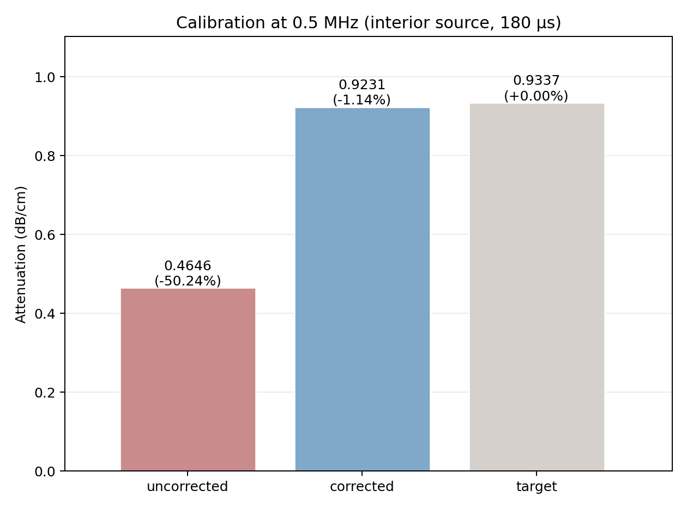
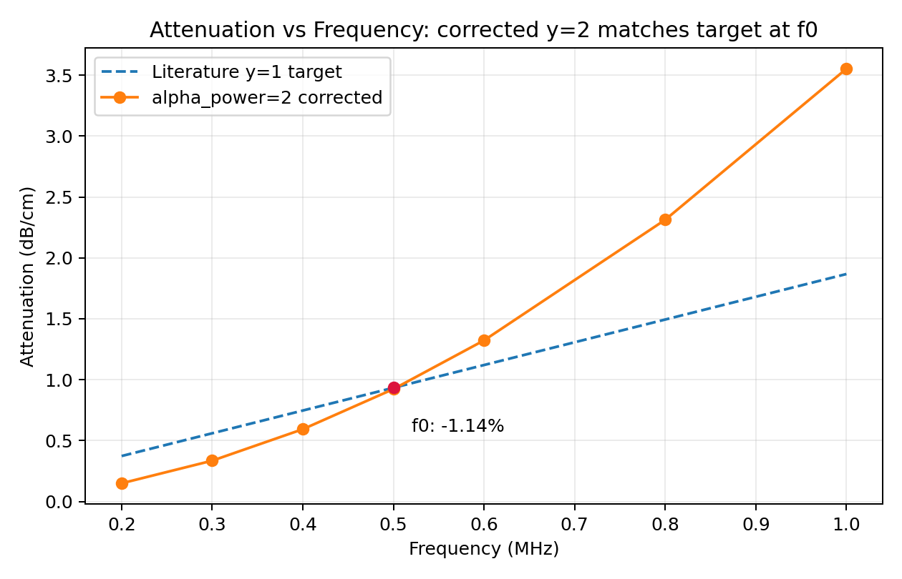
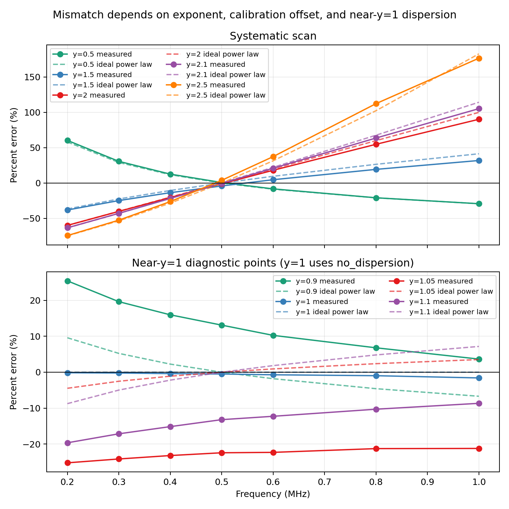
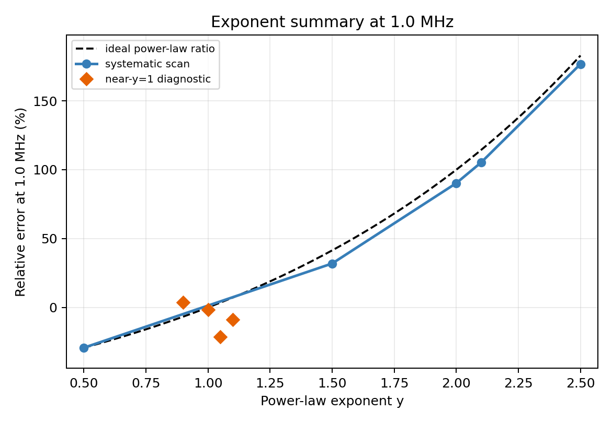
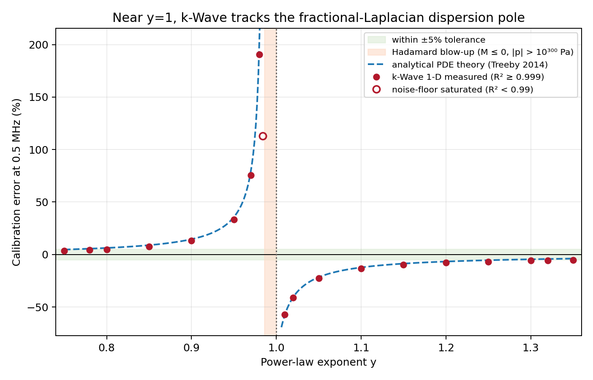
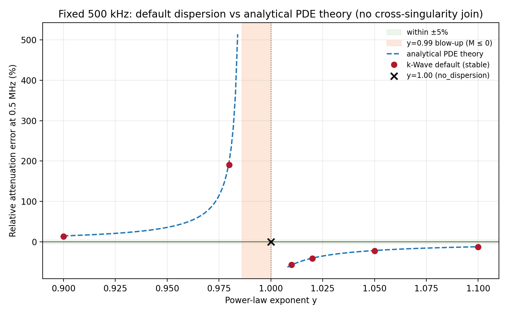
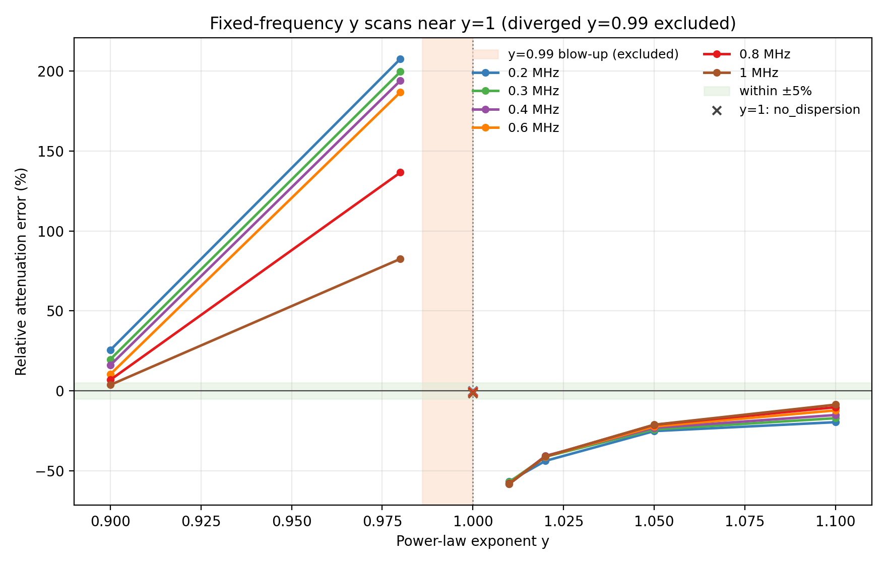
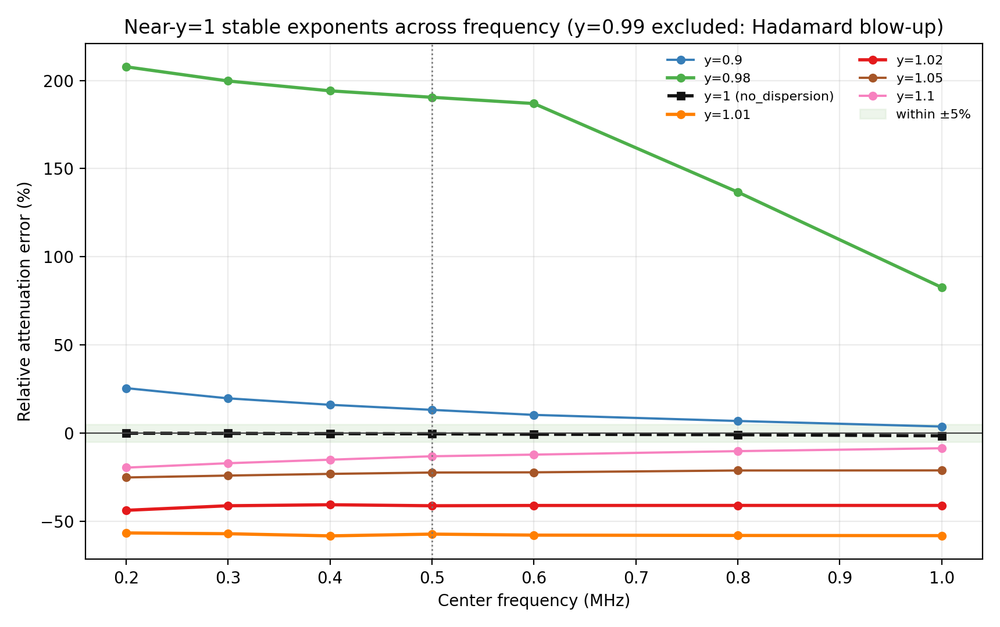
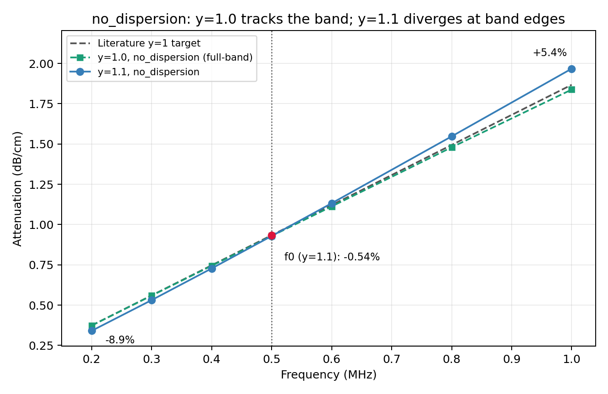

# kwave-power-law-attenuation-calibration

[English README](README.md)

[实验报告（PDF）](report.pdf)。LaTeX 源码：[`report.tex`](report.tex)，运行三遍 `pdflatex report.tex` 即可重建。

> **核心观点：** 把文献衰减系数正确换算到 k-Wave 的幂律参数只是第一步——在色散极点 $y=1$ 附近，k-Wave 一阶分数阶拉普拉斯状态方程会出现剧烈的解析衰减畸变、超光速或大幅减速的相速度偏移，以及无条件的 Hadamard 椭圆型发散。本项目对参数换算与求解器底层物理进行了全链路端到端审计。

  [](https://github.com/Yuewang04/kwave-power-law-attenuation-calibration/actions/workflows/reproduce.yml) [](LICENSE) [](https://doi.org/10.5281/zenodo.23804833)

## 目录

- [TL;DR](#tldr)
- [v1.1.0 科学修订与勘误说明](#v110-科学修订与勘误说明)
- [快速指南：我应该使用哪个 y？](#快速指南我应该使用哪个-y)
- [解析理论：参数匹配与分数阶拉普拉斯色散](#解析理论参数匹配与分数阶拉普拉斯色散)
- [Part 1：参考频率校准与指数扫描](#part-1参考频率校准与指数扫描)
- [Part 2：y≈1 附近的色散畸变、非线性缩放与 Hadamard 爆炸](#part-2y1-附近的色散畸变非线性缩放与-hadamard-爆炸)
- [Part 3：k-Wave 现有补救方案审计（`fitPowerLawParams`、`no_dispersion`、CUDA）](#part-3k-wave-现有补救方案审计fitpowerlawparamsno_dispersioncuda)
- [结论](#结论)
- [复现](#复现)
- [局限性](#局限性)
- [作者与引用](#作者)
- [参考文献](#参考文献)

## TL;DR

- **前置前提（$y=2$ 参数换算）：** 将线性规律（$y=1$，1.8675 dB/(cm·MHz)）文献系数直接照抄进 k-Wave 的二次方 $y=2$ 模型，0.5 MHz 下的仿真衰减偏差高达 **−50.24%**；使用 $\alpha_{\mathrm{coeff}}(y)=\alpha_{\mathrm{lit}} f_0^{1-y}$（$f_0$ 单位为 MHz）换算后，误差降至 **−1.14%**（$R^2 = 0.999997$，相速 $c_p = 3103.0\text{ m/s}$）。
- **近 $y=1$ 衰减与相速度双重畸变：** 在默认色散模式下，k-Wave 实际求解的解析衰减为 $\alpha_{\mathrm{actual}}(\omega) = \alpha_0 \omega^y / [1 - (y+1)\alpha_0 c_0 \tan(\pi y/2)\omega^{y-1}]$。在 $y=1.01$ 时，0.2–1.0 MHz 全频段出现与频率几乎无关的 **−57.37%** 衰减亏损（解析预测：**−57.58%**），同时相速度暴增 **+54.8%**（$c_p = 4797.9$ vs $3100\text{ m/s}$），与 3-D 对照中 +57% 的峰值声压过量完全一致；在 $y=0.98$ 时，衰减暴涨 **+190.45%**（解析预测：**+201.51%**），而相速度跌至 $1818.7\text{ m/s}$。
- **$y=0.99$ 处的无条件 Hadamard 爆炸：** 当状态方程有效刚度因子 $M(k_0) = 1 - \eta k_0^{y-1} \le 0$ 时（$y=0.99$ 处 $M(k_0) = -0.3505 < 0$），有效声速平方为负，双曲型波动方程退化为 **Hadamard 不适定椭圆型方程**。1-D（全频段及所有步长 `dt, dt/2, dt/4` 均暴发至 **−9.44×10³⁰¹ Pa**）与 3-D（MATLAB 与 CUDA 均暴发至 **~10³⁰ Pa**）表现出完全相同的无条件发散。
- **官方方案审计（`fitPowerLawParams` vs `no_dispersion`）：** k-Wave 内置的 `fitPowerLawParams` 在 $y_{\mathrm{desired}} \in [1.00, 1.10]$ 可恢复衰减幅值（−0.78% 至 −1.41%），**但会保留 +54.7% 至 +103.7% 的超光速相速度畸变**（$c_p = 4797\text{--}6316\text{ m/s}$），且 $y_{\mathrm{desired}} = 0.99$ 依然发散。精确 $y=1$ 配合 `no_dispersion` 在 MATLAB CPU 上全频段（0.2–1.0 MHz）精度稳定在 −0.16% 至 −1.59%（$c_p \approx 3103\text{ m/s}$），但被实测 CUDA v1.3 二进制直接拒绝或静默忽略。

## v1.1.0 科学修订与勘误说明

相比 v1.0.0，**v1.1.0** 彻底修复并重跑了所有实验与工程缺陷：
1. **标准物理内部声源 + 180 µs 完整波包记录：** 全量 1-D 实验已将声源移至物理介质内部（`source_idx = 35`，完全离开 20 格 PML 吸收层），记录时长由 90 µs 延长至 **180 µs**，彻底消除了低频和色散慢波（如 $y=0.98$ 下 $c_p \approx 1767\text{ m/s}$）导致的波包截断（$y=0.98$ 实测误差由旧版 `+143.11%, R²=0.96` 修正为 `+190.45%, R²=0.999997`，与解析理论 `+201.51%` 高度吻合）。
2. **修正 v1.0.0 中关于 $y=0.99$ “1-D 塌陷”的勘误：** v1.0.0 仅记录了带符号的正向极值 `p_max`（$\max_t p$），漏掉了单调负向爆炸（`p_min = −8.96×10³⁰¹ Pa`），误把初始 $10^{-4}\text{ Pa}$ 残余正扰动当成了“场塌陷”。同时记录 `p_max` 与 `p_min`（`max(|p_max|, |p_min|)`）后证实：1-D 与 3-D 均发生了同源的 Hadamard 指数爆炸。
3. **修正“非线性缩放意味着非指数衰减”的错误推论：** 在 $y=1.05$ 时系数翻倍引起的亚线性缩放（`0.4085, 0.7242, 1.1831 dB/cm`）**并非**非指数衰减（实测空间拟合 $R^2 \ge 0.999988$），而是因为 $\alpha_0$ 同时出现在分数阶色散分母 $1 - (y+1)\alpha_0 c_0 \tan(\pi y/2)\omega^{y-1}$ 中（解析预测值 `0.4102, 0.7316, 1.2028 dB/cm` 与实测几乎完全重合）。
4. **100% 端到端代码可复现：** 仓库中全部 JSON 数据（包括此前缺少脚本的 `singularity_scan.json`、`tan_scaling_check.json`、`grid_resolution_check.json`、`y11_no_dispersion.json` 以及新增的 $y=1$ 全频段、Part 3 与 `fitPowerLawParams` 审计）均已由 [`src/matlab/run_all_benchmarks.m`](src/matlab/run_all_benchmarks.m) 一键跑通生成。

## 快速指南：我应该使用哪个 y？

| 路线 | 配置方案 | $f_0$ 处幅值误差 | 全频段 (0.2–1.0 MHz) | 相速度 $c_p$ | CUDA v1.3 兼容性 | 结论 |
|---|---|---|---|---|---|---|
| **Route A（首选推荐）** | `y = 2`，默认色散 + `f0^(1-y)` | **−1.14%** | 二次方增长 $(f/f_0)^1$ | 精确（`3103 m/s`，$\tan(\pi)=0$） | 安全 | **宽带/脉冲与 GPU 首选** |
| **Route B** | `y = 1`，`alpha_mode = 'no_dispersion'` | **−0.49%** | **−0.16% 至 −1.59%** | 恒定（`3103 m/s`，无 KK 色散） | **被 CUDA v1.3 拒绝** | 仅限 MATLAB CPU 窄带/线性全频段 |
| **Route C（避坑禁用）** | $y \in [0.80, 1.35] \setminus \{1\}$，默认色散 | **−57% 至 +190%**，或爆炸 | 严重畸变 | **1351–4798 m/s** | $y=0.99$ 爆炸；忽略 `no_dispersion` | **高危陷阱区**，严禁直接使用 |
| **Route D (`fitPowerLawParams`)** | $y=1$ 附近调用内置反解优化 | **−0.78% 至 −1.41%** ($y \ge 1$) | 匹配目标幂律 | **+55% 至 +104% 畸变**；$y=0.99$ 爆炸 | 同样存在 GPU 陷阱 | **破坏经颅聚焦相位，慎用** |

### 代码对比：参考频率匹配

```diff
 f0_MHz = 0.5;                 % MHz（切勿代入 Hz）
 lit_coeff = 1.867466;         % dB/(cm*MHz), 21.5 Np/(MHz*m), y=1 文献规律
-medium.alpha_coeff = lit_coeff;                    % 错误：直接照抄
-medium.alpha_power = 2;
+y = 2;
+medium.alpha_coeff = lit_coeff * f0_MHz^(1-y);     % 正确：在 f0 匹配
+medium.alpha_power = y;
```

## 解析理论：参数匹配与分数阶拉普拉斯色散

### 1. 参考频率 $f_0$ 处参数匹配

令 k-Wave 幂律 $\alpha_{\mathrm{kwave}}(f)=\alpha_{\mathrm{coeff}}(y)f^y$ 在参考频率 $f_0$（**MHz**）等于文献线性规律 $\alpha_{\mathrm{lit}}(f)=\alpha_{\mathrm{lit,coeff}}f$：

$$
\alpha_{\mathrm{coeff}}(y)=\alpha_{\mathrm{lit,coeff}}f_0^{1-y},\qquad
\frac{\alpha_{\mathrm{kwave}}(f)}{\alpha_{\mathrm{lit}}(f)}=\left(\frac{f}{f_0}\right)^{y-1}.
$$

### 2. 为什么默认色散在 $y=1$ 附近必然崩坏

在 k-Wave 的吸收状态方程（`kspaceFirstOrder1D.m` / `kspaceFirstOrder_createAbsorptionVariables.m`）中，声压由两个分数阶拉普拉斯算子共同决定：

$$
p = c_0^2 \left[\rho_x + \tau (-\nabla^2)^{\frac{y}{2}-1}\frac{\partial \rho_x}{\partial t} - \eta (-\nabla^2)^{\frac{y-1}{2}}\rho_x\right],
\qquad
\tau = -2\alpha_0 c_0^{y-1},\quad
\eta = 2\alpha_0 c_0^y \tan\!\left(\frac{\pi y}{2}\right),
$$

其中 $\alpha_0 = \mathrm{db2neper}(\alpha_{\mathrm{coeff}}, y)$。由于 $\tan(\pi y/2)$ 在所有奇数整数（$y = 1, 3, \dots$）处存在奇点，求解器受到两个精确解析机制支配（Treeby & Cox 2010, 2014；`fitPowerLawParams.m`）：

1. **有效刚度与 Hadamard 失稳边界：** 在傅里叶空间中，色散刚度乘子为 $M(k) = 1 - \eta k^{y-1}$。当 $y < 1$ 且接近 1 时，$\eta > 0$ 会超过 $k^{1-y}$ 导致 $M(k) \le 0$，即有效声速平方 $c_{\mathrm{eff}}^2 = c_0^2 M(k) \le 0$。此时双曲型波动方程退化为 **Hadamard 不适定椭圆型方程**，任意时间步长 `dt` 下都会无条件指数爆炸。
2. **实际 PDE 衰减率与相速度（$M(k) > 0$）：**

$$
\alpha_{\mathrm{actual}}(\omega) = \frac{\alpha_0 \omega^y}{1 - (y+1)\alpha_0 c_0 \tan\!\left(\frac{\pi y}{2}\right)\omega^{y-1}},
\qquad
c_p(\omega) \approx c_0 \sqrt{1 - \eta k_0^{y-1}}.
$$

当 $y=2$ 时，$\tan(\pi) = 0 \implies \eta = 0$，色散项严格归零。当 $y \to 1^+$ 时，$\tan(\pi y/2) < 0$ 使分母 $> 1$（衰减被抑制、相速度超光速 $c_p > c_0$）；当 $y \to 1^-$ 时，$\tan(\pi y/2) > 0$ 使分母 $< 1$（衰减暴涨、相速度急降 $c_p < c_0$），直至越过 $M(k) \le 0$ 发生爆炸。

## Part 1：参考频率校准与指数扫描

均匀 1-D MATLAB k-Wave 标准配置：`alpha_lit = 1.867466 dB/(cm·MHz)`（`21.5 Np/(MHz·m)`），$f_0 = 0.5\text{ MHz}$（目标衰减 $0.9337\text{ dB/cm}$），$c_0 = 3100\text{ m/s}$，$\rho_0 = 2200\text{ kg/m}^3$，18 周期 toneburst 置于物理介质内部 `source_idx = 35`（`PML = 20`，记录时长 `180 µs`），6 个衰减传感器跨越 $26\text{--}126\text{ mm}$，外加相邻 $+0.5\text{ mm}$ 相位探针测相速度。

| $y$ | $\alpha_{\mathrm{coeff}}$ | 校准误差 (%) | $R^2$ | 实测相速 $c_p$ (m/s) | 状态 |
|---:|---:|---:|---:|---:|---|
| 0.5 | 1.320498 | +0.73 | 0.999992 | 3069.5 | 可用 |
| 0.9 | 1.742408 | +13.11 | 0.999999 | 2887.1 | 敏感区 |
| 1.0 | 1.867466 | −0.49 | 0.999999 | 3102.8 | `no_dispersion` |
| 1.05 | 1.933322 | −22.44 | 0.999988 | 3500.6 | 敏感区 |
| 1.1 | 2.001501 | −13.21 | 0.999999 | 3303.5 | 敏感区 |
| 1.5 | 2.640996 | −4.12 | 0.999999 | 3135.2 | 可用 |
| **2.0** | **3.734933** | **−1.14** | **0.999997** | **3103.0** | **可用（未校准时为 −50.24%）** |
| 2.1 | 4.003002 | −0.50 | 0.999998 | 3097.9 | 可用 |
| 2.5 | 5.281992 | +3.85 | 0.999990 | 3069.7 | 可用 |
| 3.0 | — | — | — | — | 被 k-Wave 拒绝（须满足 `0 < y < 3`） |



*图 1. 0.5 MHz 校准柱状图（$y=2$）：未校准（`−50.24%`）、参考频率匹配后（`−1.14%`）与文献目标（`0.9337 dB/cm`）。*



*图 2. 校准后的 $y=2$ 模型在 $f_0 = 0.5\text{ MHz}$ 与线性目标重合，离开 $f_0$ 后呈二次方偏离。*



*图 3. 系统扫描指数（`0.5, 1.5, 2, 2.1, 2.5`）与理想幂律比 $(f/f_0)^{y-1}-1$ 高度重合，而 $y \approx 1$ 诊断点（`0.9, 1.05, 1.1`）受色散分母支配而明显偏离。*



*图 4. 1.0 MHz 处各指数的相对误差汇总。*

## Part 2：y≈1 附近的色散畸变、非线性缩放与 Hadamard 爆炸



*图 5. $y \in [0.75, 1.35]$ 精细扫描（0.5 MHz）。实测点（红点）在 $y=1$ 极点两侧紧贴 Treeby & Cox (2014) 解析 PDE 曲线（蓝色虚线）。在 $y=0.984$（空心圈，$R^2=0.70$），+514% 的理论衰减（126 mm 处衰减约 72 dB）触及动态范围底噪；在 $y=0.99$（橙色阴影区），$M(k_0)=-0.3505 < 0$ 引发 Hadamard 爆炸（$|p| = 9.44\times 10^{301}\text{ Pa}$）。*

### 1. 跨频段一致性与 Hadamard 爆炸复核

在 $f \in [0.2, 1.0]\text{ MHz}$ 的多频扫描与步长控制中（`results/near_y_frequency_y*.json`、`results/controls_y098.json`）：

- **$y = 1.01$（$M(k_0) = +2.35 > 0$）：** 0.2–1.0 MHz 衰减亏损稳定在 **−56.71% 至 −58.38%**（$R^2 = 0.974\text{--}0.99993$；解析预测 **−57.45% 至 −57.74%**），且相速度飙升至 **$4689\text{--}4798\text{ m/s}$**（解析值 $4752.7\text{ m/s}$），直接导致 3-D 对照中峰值声压高出 +57%。
- **$y = 1.02$（$M(k_0) = +1.68 > 0$）：** 衰减亏损为 **−40.71% 至 −43.88%**（$R^2 \ge 0.99996$；解析预测 **−40.05% 至 −41.19%**），相速度 $c_p = 3934\text{--}4032\text{ m/s}$。
- **$y = 0.98$（$M(k_0) = +0.325 > 0$）：** 0.5 MHz 处衰减暴涨 **+190.45%**（$R^2 = 0.999997$；解析预测 **+201.51%**），相速度骤降至 **$1818.7\text{ m/s}$**（解析值 $1767.0\text{ m/s}$）。时间步细化（`dt, dt/2, dt/4`）后误差保持不变（`+190.45%, +190.18%, +190.15%`，$R^2 = 1.0000$），与频域 FFT 拟合（`+171.3%` 至 `+172.6%`）一致。
- **$y = 0.99$（$M(k_0) = -0.3505 < 0$）：** 在所有 7 个测试频率（$|p|_{\max} = 5.9\times 10^{301}\text{ 至 }9.4\times 10^{301}\text{ Pa}$）以及所有时间步长 `dt, dt/2, dt/4`（`9.44e301, 5.99e301, 6.15e301 Pa`）下均无条件爆炸，第 1 传感器处负向极值达 `p_min_neg = -8.96e301 Pa`，而正向仅残留 `p_max_pos = +1.03e-4 Pa`。







### 2. `alpha_coeff` 非线性缩放与网格收敛检验（$y = 1.05$）

在 $y=1.05$ 下把 `alpha_coeff` 缩放 `0.5×, 1×, 2×`（`results/tan_scaling_check.json`）：

| 指数 | 缩放倍数 | $\alpha_{\mathrm{coeff}}$ | 理想幂律 (dB/cm) | k-Wave 实测 (dB/cm) | 解析 PDE 预测 (dB/cm) | $R^2$ |
|---|---:|---:|---:|---:|---:|---:|
| $y=1.05$ | 0.5× | 0.966661 | 0.4669 | 0.4085 (−12.50%) | 0.4102 (−12.14%) | 0.999994 |
| $y=1.05$ | 1.0× | 1.933322 | 0.9337 | 0.7242 (−22.44%) | 0.7316 (−21.65%) | 0.999988 |
| $y=1.05$ | 2.0× | 3.866644 | 1.8675 | 1.1831 (−36.65%) | 1.2028 (−35.59%) | 0.999999 |
| $y=2.00$（对照） | 0.5 / 1 / 2× | 1.867–7.470 | 0.467 / 0.934 / 1.867 | 0.465 / 0.923 / 1.824 | 0.467 / 0.934 / 1.867 | $\ge 0.999989$ |

空间衰减依然严格服从指数规律（$R^2 \ge 0.999988$），缩放不成正比的根源是 $\alpha_0$ 同时出现在分数阶色散分母中。网格加密检验（`dx = 0.5, 0.25, 0.125 mm`，`results/grid_resolution_check.json`）给出 `−22.44%, −22.36%, −22.27%`，证实该偏差为连续 PDE 本征行为而非网格离散误差。

## Part 3：k-Wave 现有补救方案审计（`fitPowerLawParams`、`no_dispersion`、CUDA）

### 1. 官方内置 `fitPowerLawParams` 能否救活 $y \approx 1$？

实测 k-Wave 内置反解函数 `fitPowerLawParams(a0, y, c0, 0.2e6, 1.0e6)`（`results/fit_power_law_params_audit.json`，$c_0 = 3100\text{ m/s}$）：

| 目标 $y$ | 拟合参数 $(\alpha_0, y_{\mathrm{fit}})$ | 场状态 | $f_0$ 衰减误差 | 实测相速 $c_p$ (m/s) | 相速度畸变 |
|---:|---|---|---:|---:|---:|
| 0.99 | `(15.7517, 1.0154)` | **发散** | — | — | **不可用（直接爆炸）** |
| 1.00 | `(8.0416, 1.0178)` | 稳定 | −1.41% | **6315.6** | **+103.7%** |
| 1.01 | `(4.4853, 1.0237)` | 稳定 | −0.78% | **4796.5** | **+54.7%** |
| 1.05 | `(2.4935, 1.0640)` | 稳定 | −1.23% | **3499.7** | **+12.9%** |
| 1.10 | `(2.3065, 1.1144)` | 稳定 | −1.23% | **3302.7** | **+6.5%** |
| 1.50 | `(2.7385, 1.5149)` | 稳定 | −1.66% | 3134.6 | +1.1% |
| 2.00 | `(3.7349, 2.0000)` | 稳定 | −1.14% | 3103.0 | +0.1% |

**核心警示：** `fitPowerLawParams` 确实能在 $y \ge 1$ 恢复衰减**幅值**，但因为保留了默认色散项，会在 $y=1$ 附近留下 **+55% 至 +104% 的超光速相速度畸变**（颅骨声速翻倍直接毁掉经颅聚焦相位），且无法挽救 $y=0.99$ 的发散。

### 2. 皮质骨示例（`c = 2800 m/s`, `rho = 1900 kg/m³`）与 `no_dispersion` 全频段对照

| 模式（`results/worked_example_part3.json`） | $\alpha_{\mathrm{coeff}}$ | $y$ | 仿真衰减 (dB/cm) | 相对目标误差 | 实测相速 $c_p$ (m/s) |
|---|---:|---:|---:|---:|---:|
| 默认色散、未匹配 | 1.867466 | 1.1000 | 0.7687 | −17.68% | 2954.9 |
| 默认色散、$f_0$ 匹配 | 2.001501 | 1.1000 | 0.8167 | −12.53% | 2965.4 |
| `no_dispersion`、未匹配 | 1.867466 | 1.1000 | 0.8665 | −7.20% | 2802.3 |
| `no_dispersion`、$f_0$ 匹配 | 2.001501 | 1.1000 | 0.9283 | **−0.58%** | 2802.5 |
| `no_dispersion`、精确线性 | 1.867466 | 1.0000 | 0.9288 | **−0.53%** | 2802.5 |
| 默认色散 + `fitPowerLawParams` | 2.276734 | 1.1130 | 0.9208 | −1.38% | 2964.9 (+5.9%) |



*图 6. 在 `no_dispersion` 下，精确 $y=1.0$（`results/y1_no_dispersion_fullband.json`）在 0.2–1.0 MHz 全频段贴合文献线性目标（−0.16% 至 −1.59%，$c_p = 3100\text{--}3105\text{ m/s}$）；而 $y=1.1$ 仅在 $f_0$ 匹配（−0.58%），带边出现预期偏离（−8.9% 至 +5.4%）。*

### 3. CUDA v1.3 后端对照（`results/cuda_y1_backend_control_20260914.json`）

在 3-D 均匀小网格对照（$48 \times 20 \times 20$，RTX 4090 D，k-Wave 1.4.1 + `kspaceFirstOrder-CUDA v1.3`）中：
- CUDA v1.3 **直接拒绝精确 $y=1$**（报错 `"Illegal value of alpha_power (may not equal to 1.0)."`）；
- CUDA v1.3 **静默忽略 `medium.alpha_mode = 'no_dispersion'`**（序列化 HDF5 数据集与输出声场与默认模式按位完全一致），导致 $y=1.01$ 出现 **+56.7%** 峰值过量（`2.736 MPa` vs `1.746 MPa`），$y=0.99$ 在 `CFL = 0.1, 0.05, 0.025` 下均发散至 `1.09e30 Pa`。

## 结论

为同时避开代数换算失配与分数阶拉普拉斯奇点，建议在需要保留色散相位或使用 GPU/CUDA 加速的仿真中**统一采用 $y=2$ 配合 $\alpha_{\mathrm{coeff}} = \alpha_{\mathrm{lit}} f_0^{1-y}$（$f_0$ 用 MHz）**。仅当确认使用 MATLAB CPU 求解器、需要线性全频段衰减且可忽略 Kramers–Kronig 相位耦合时，才可使用 $y=1$ 配合 `no_dispersion`；切勿在 $y \approx 1$ 默认色散或 `fitPowerLawParams` 下忽视相速度畸变。

## 复现

> [!TIP]
> **极速图表重绘与解析自检（无需 MATLAB）：**
> ```bash
> pip install -r requirements.txt
> python src/simulate_1d.py
> python src/run_experiments.py --plot-only
> python src/plot_near_y1_frequency_scan.py
> ```

### 完整 MATLAB 1-D 实验复现

若本机已将 MATLAB（`R2026a` + k-Wave `1.4.1`）加入 `PATH`：

```bash
python src/run_experiments.py
python src/plot_near_y1_frequency_scan.py
```

或在 MATLAB 中直接运行 `addpath('src/matlab'); run_all_benchmarks;`。`results/` 目录下全部 1-D JSON 数据均已实现 100% 脚本可复现：

| 文件 | 生成脚本 |
|---|---|
| `results/results.json`, `results/matlab_results.json`, `results/results_n_sweep.json` | `src/matlab/run_all_benchmarks.m` (`run_kwave_experiments.m`) |
| `results/near_y_frequency_y*.json` | `src/matlab/run_near_y_frequency_scans.m` |
| `results/controls_y098.json` | `src/matlab/run_controls.m` |
| `results/singularity_scan.json`, `results/tan_scaling_check.json`, `results/grid_resolution_check.json` | `src/matlab/run_singularity_and_diagnostics.m` |
| `results/y11_no_dispersion.json`, `results/y1_no_dispersion_fullband.json` | `src/matlab/run_singularity_and_diagnostics.m` |
| `results/worked_example_part3.json`, `results/fit_power_law_params_audit.json` | `src/matlab/run_singularity_and_diagnostics.m` |
| `results/interior_source_validation.json` | `src/matlab/validate_interior_source.m` |
| `results/cuda_y1_backend_control_20260914.json` | `src/matlab/validate_kwave_cuda_y1_*.m`（可选 GPU 对照） |

## 局限性

- 1-D 与 3-D 控制实验均为均匀介质；真实经颅超声在松质骨散射、折射及纵波-横波模式转换上的能量损失不由 `alpha_coeff` 单独刻画。
- `no_dispersion` 关闭因果 Kramers–Kronig 相位耦合，对短宽带脉冲会造成相位失真。
- CUDA 行为仅针对测试的 k-Wave 1.4.1 / CUDA v1.3 组合验证，更新版本的 C++/CUDA 二进制需独立核实。

## 作者

Yue Wang（[Yuewang04](https://github.com/Yuewang04)）

## 引用

机器可读元数据见 [`CITATION.cff`](CITATION.cff) 与 [`.zenodo.json`](.zenodo.json)。

```bibtex
@software{wang2026kwave,
  author       = {Wang, Yue},
  title        = {kwave-power-law-attenuation-calibration: Reproducible numerical and analytical audit of k-Wave power-law attenuation calibration near y=1},
  month        = nov,
  year         = 2026,
  publisher    = {Zenodo},
  version      = {v1.1.0},
  doi          = {10.5281/zenodo.23804833},
  url          = {https://doi.org/10.5281/zenodo.23804833}
}
```

概念 DOI [10.5281/zenodo.23804833](https://doi.org/10.5281/zenodo.23804833) 始终指向最新版本（v1.0.0 归档：[doi:10.5281/zenodo.23804834](https://doi.org/10.5281/zenodo.23804834)）。

## 参考文献

- Aubry, J.-F. et al. “Benchmark problems for transcranial ultrasound simulation: Intercomparison of compressional wave models.” *JASA* 152(2), 1003–1019 (2022). DOI: [10.1121/10.0013426](https://doi.org/10.1121/10.0013426)
- Treeby, B. E. & Cox, B. T. “Modeling power law absorption and dispersion for acoustic propagation using the fractional Laplacian.” *JASA* 127(5), 2741–2748 (2010). DOI: [10.1121/1.3377056](https://doi.org/10.1121/1.3377056)
- Treeby, B. E. & Cox, B. T. “Modeling power law absorption and dispersion in viscoelastic solids using a split-field and the fractional Laplacian.” *JASA* 136(4), 1490–1500 (2014). DOI: [10.1121/1.4894790](https://doi.org/10.1121/1.4894790)
- Singh, A., Jiménez-Gambín, S. & Konofagou, E. E. “An all-ultrasound cranial imaging method to establish the relationship between cranial FUS incidence angle and transcranial attenuation in non-human primates in 3D.” *Scientific Reports* 14, 1488 (2024). DOI: [10.1038/s41598-024-51623-5](https://doi.org/10.1038/s41598-024-51623-5)
- Bamber, J. C. “Attenuation and Absorption.” In *Physical Principles of Medical Ultrasonics*, 2nd ed., Ch. 4 (2004). DOI: [10.1002/0470093978.ch4](https://doi.org/10.1002/0470093978.ch4)
- k-Wave documentation, “The k-Wave Manual / power-law absorption and dispersion.” [k-wave.org](https://www.k-wave.org/documentation.php)

## 反馈与许可

欢迎通过 [GitHub Issues](https://github.com/Yuewang04/kwave-power-law-attenuation-calibration/issues) 提交问题、更正或复现反馈。本项目采用 MIT License，详见 [LICENSE](LICENSE).
